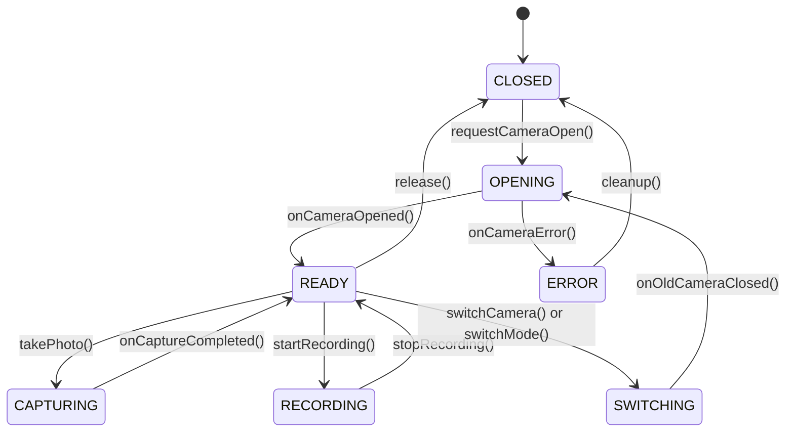

# Architecture Specification | Xamera (Adaptive Camera)

**Project:** Xamera  
**Package:** `com.bishal.adaptivecamera`  
**Workspace:** `D:\Webapp\xamera`  
**Repository:** https://github.com/arybishal/Xamera  
**Developer:** Bishal Aryal  
**Version:** 0.15.0  
**Date:** 2026-11-06  

> [!NOTE]
> The full living architectural specification is maintained at [docs/ARCHITECTURE.md](file:///D:/Webapp/xamera/docs/ARCHITECTURE.md).

---

## 1. Architectural Philosophy: Hardware Intelligence First

Xamera is designed around **Hardware Intelligence First**:
- **Discovery Before Configuration:** Camera features are never statically assumed based on device marketing or vendor names. Instead, the Android `CameraManager` and `CameraCharacteristics` metadata are queried at runtime, parsed across 16 capability dimensions, and cached in a centralized `CameraCapabilityRepository`.
- **Strict Boundary Separation:** Hardware sessions and OpenGL rendering pipelines never run inside UI composables. State flows through unidirectional data flows (UDF) via Kotlin Coroutines and `StateFlow`.
- **Hybrid Camera Engine:**
  - **CameraX:** Serves as the robust, lifecycle-aware foundation for standard preview, standard photo, and standard video recording.
  - **Camera2:** Engaged when advanced manual sensor controls (explicit ISO / exposure time in nanoseconds), physical camera stream mapping, or RAW/DNG capture is required.
  - **Session Isolation:** An explicit finite state machine prevents CameraX and direct Camera2 sessions from competing for hardware control or leaking sensor allocations.

---

## 2. Package Architecture

```text
com.bishal.adaptivecamera
│
├── core/
│   ├── common/              # Common Result types, Dispatchers, Constants
│   ├── diagnostics/         # DeviceInfo, OEM detection, system telemetry, thermal monitor
│   ├── display/             # 120Hz display refresh rate manager & display mode selector
│   ├── permissions/         # Camera and Audio permission handling
│   ├── settings/            # User settings management & DataStore (Theme, Quality, Watermark)
│   ├── storage/             # Scoped storage, MediaStoreManager, RAW vault
│   ├── sensors/             # Gyroscope & Accelerometer virtual horizon sensors
│   ├── haptics/             # System tactile haptic feedback engine
│   ├── peripherals/         # Bluetooth LE remote shutter & gimbal protocol handlers
│   └── lifecycle/           # Camera lifecycle observers & quick launch intents
│
├── camera/
│   ├── capability/          # CapabilityScanner, CapabilityProfile, Repository
│   ├── discovery/           # Camera device enumerator & hardware validator
│   ├── session/             # Session state machine (CLOSED, OPENING, READY, etc.)
│   ├── preview/             # Surface providers and viewfinder adapters
│   ├── capture/             # Photo capture dispatchers, ZSL ring buffer, AEB controller
│   └── controls/            # ExposureController, FocusController, ZoomController
│
├── intelligence/
│   ├── scene/               # Rule-based scene categorization (Portrait, Landscape, Night, etc.)
│   ├── analysis/            # Unified PhotometryAnalyzer (Histogram, Zebra, False Color)
│   ├── evaluator/           # Lighting and exposure evaluators
│   └── policies/            # Camera parameter & lens recommendation engines
│
├── photography/
│   ├── auto/                # Smart Auto orchestrator & suggestion chip
│   ├── pro/                 # Camera2ManualEngine, ISO/Shutter/Focus/Kelvin controllers
│   ├── raw/                 # RAW_SENSOR capture, DngCaptureManager, DngCreator
│   ├── computational/       # Multi-frame Image Stacking, FrameAlignmentEngine, MotionEstimationEngine, ImageFusionEngine
│   ├── portrait/            # Dedicated Portrait mode, PortraitBokehRenderer, SubjectSegmentationEngine, PortraitControlBar
│   ├── watermark/           # PhotoWatermarkCompositor, text & PNG logo overlay
│   └── capture/             # ZSL ring buffer, AEB exposure coordinator
│
├── video/
│   ├── recording/           # Pro video engine, GpuVideoRecorder, and recording coordinator
│   ├── modes/               # Time-Lapse and Slow-Motion configurations & calculations
│   ├── capability/          # DualCameraCapabilityDetector and concurrent pipeline gating
│   ├── profiles/            # Resolution, FPS, and bitrate validators
│   ├── encoder/             # MediaCodec video pipeline & GPU video encoder
│   ├── audio/               # Audio routing manager & real-time VU meter processor
│   ├── stabilization/       # OIS, EIS, and Super Steady coordinator
│   └── export/              # VideoExportEngine, SocialExportPreset, VideoExportViewModel, VideoExportSheet
│
├── lut/
│   ├── library/             # LUT repository and cache
│   ├── parser/              # .cube 3D LUT parser and numerical validator
│   ├── presets/             # Built-in presets (Natural, Warm, Cool, Contrast, Vintage)
│   ├── profiles/            # Log tone curves (Flat, S-Log/Log-C emulations)
│   └── database/            # Room database for user LUTs and metadata
│
├── graphics/
│   ├── egl/                 # EGLDisplay, EGLContext, EGLSurface lifecycle management
│   ├── opengl/              # OpenGL ES 3.0 shaders, programs, and 3D texture loaders
│   ├── shaders/             # LUT 3D, Film Grain, Halation, False Color shaders
│   └── framepipeline/       # Unified GPU render pipeline (OES to Viewfinder/Encoder)
│
├── gallery/
│   ├── media/               # MediaStore entity models & DNG metadata
│   ├── repository/          # Scoped gallery query repository
│   ├── viewer/              # Zoomable photo viewer & video player
│   └── export/              # DNG/JPEG export and share actions
│
└── ui/
    ├── camera/              # Main camera screen, viewfinder, pro controls
    │   ├── components/      # Viewfinder overlays, zoom dial, grids, level, shutter
    │   ├── pro/             # ProControlBar, HistogramView, FocusPeakingOverlay
    │   └── video/           # ProVideoControlBar, AudioVuMeterView
    ├── diagnostics/         # Hardware diagnostic inspection screen
    ├── settings/            # Dedicated settings & "Check Hardware Capability" screen
    ├── lut/                 # LUT selection drawer, slider, and comparison
    └── theme/               # Dark, Light (Yellow/Black/White), System themes, colors, typography, haptics
```

---

## 3. Deduplication Architecture & Shared Pipelines

The system enforces single-controller contracts across all critical domains:
1. **One Exposure Controller:** Unified state arbitrating hardware AE compensation versus manual sensor ISO & Shutter speed. UI prevents conflicting or illegal HAL calls.
2. **One Photometric Engine:** Unified `PhotometryAnalyzer` pipeline processing downsampled YUV frames / GPU passes to feed Histogram, Live Zebra Striping (IRE 70%–100%), and Full-Spectrum False Color heatmap without duplicate preview taps.
3. **One Focus Controller:** Manages Continuous AF, Tap Focus, AF Lock, and Manual Diopters. Passive focus peaking and preview magnification operate without interfering with lens mechanics.
4. **One Zoom Controller:** Pinch gestures, step buttons, rotary zoom dial, and multi-lens switching route through `setZoomRatio(target)`.
5. **One Framing Configuration:** Aspect ratio state (`4:3`, `16:9`, `1:1`, `FULL`, `2.39:1`) drives both viewfinder overlays and captured image crop matrices.
6. **One RAW Engine:** RAW, JPEG/HEIC, and RAW+JPEG/HEIC are output configurations of a single `takePhoto()` dispatch.
7. **One GPU Render Graph:** Unified OpenGL ES 3.0 shader graph serving live preview, graded photo capture, and graded video recording.
8. **One Video Configuration Model:** Shared configuration coordinating Resolution, FPS, Bitrate, Shutter Angle, Stabilization, and Audio Routing.
9. **Centralized Hardware Repository:** Hardware discovery runs via `CameraCapabilityScanner` and resides in `CameraCapabilityRepository`.

---

## 4. Session State Machine



---

## 5. Unified GPU Render Graph

```text
Camera Hardware (Camera2 / CameraX)
            │
            ▼
   SurfaceTexture (OES Texture)
            │
            ▼
    OpenGL ES 3.0 Pipeline
   ┌────────────────────────────────────────────────────────┐
   │ 1. Log / Gamma Transfer Transform (Log profiles)       │
   │ 2. 3D Texture Sampling (Adobe .cube Trilinear Filter)   │
   │ 3. Uniform Intensity Mixing (0% - 100%)                │
   │ 4. Procedural Film Grain Shader (35mm / 16mm noise)    │
   │ 5. Photochemical Halation Glow Shader (Specular edge)  │
   └────────────────────────────────────────────────────────┘
            │
       ┌────┴───────────────────────────┬────────────────────────┐
       ▼                                ▼                        ▼
Screen Preview Surface       Encoder Input Surface     Capture Pixel Buffer
(EGLSurface for Viewfinder)  (MediaCodec Surface MP4)  (PBO / Bitmap for JPEG)
```

---

## 6. Security & Privacy Guarantees

1. **Zero External Network Dependencies:** No cloud APIs, no remote telemetry, no external SDK trackers.
2. **100% On-Device Processing:** All RAW, DNG, JPEG, LUT, Video, AI Scene Classification, and Document/Barcode scanning execute strictly on-device using local CPU/GPU/NPU.
3. **Scoped Storage Compliance:** Media is saved strictly via Android `MediaStore` into `Pictures/AdaptiveCamera` and `Movies/AdaptiveCamera`. Private RAW vault captures remain non-indexed in isolated app storage.
4. **Privacy Metadata Management:** Optional "Strip EXIF" toggle strips GPS coordinates, device serial numbers, and sensitive metadata prior to file writing.
