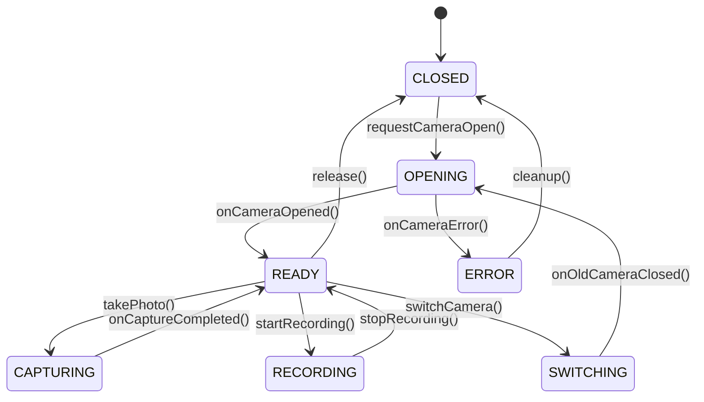

# Architecture Specification | Adaptive Camera

## 1. Architectural Philosophy

Adaptive Camera is designed around **Hardware Intelligence First**:
- **Discovery Before Configuration:** Camera features are never statically assumed based on device marketing or vendor names. Instead, the Android `CameraManager` and `CameraCharacteristics` metadata are queried at runtime.
- **Strict Boundary Separation:** Hardware sessions and OpenGL rendering pipelines never run inside UI composables. State flows through unidirectional data flows (UDF) via Kotlin Coroutines and `StateFlow`.
- **Hybrid Camera Engine:**
  - **CameraX:** Serves as the robust, lifecycle-aware foundation for standard preview, standard photo, and standard video recording.
  - **Camera2:** Engaged when advanced manual control (explicit sensor ISO/exposure time), physical camera stream mapping, or RAW/DNG capture is required.
  - **Session Isolation:** An explicit state machine prevents CameraX and direct Camera2 sessions from competing for hardware control.

---

## 2. Package Architecture

```text
com.bishal.adaptivecamera
│
├── core/
│   ├── common/              # Common Result types, Dispatchers, Constants
│   ├── diagnostics/         # DeviceInfo, OEM detection, system telemetry
│   ├── permissions/         # Camera and Audio permission handling
│   ├── settings/            # User settings management
│   ├── storage/             # Scoped storage & file paths
│   └── lifecycle/           # Camera lifecycle observers
│
├── camera/
│   ├── capability/          # CapabilityScanner, CapabilityProfile, Status
│   ├── discovery/           # Camera device enumerator & hardware validator
│   ├── session/             # Session state machine (OPENING, READY, CAPTURING, etc.)
│   ├── preview/             # Surface providers and viewfinder adapters
│   ├── capture/             # Photo capture dispatchers
│   └── controls/            # AE, AF, AWB, Zoom controllers
│
├── intelligence/
│   ├── scene/               # Rule-based scene categorization (Night, Portrait, etc.)
│   ├── analysis/            # Frame luminance, histogram, and motion estimation
│   ├── evaluator/           # Lighting and exposure evaluators
│   └── policies/            # Camera parameter recommendation engines
│
├── photography/
│   ├── auto/                # Smart Auto orchestrator
│   ├── pro/                 # Manual ISO, Shutter, Manual Focus controller
│   ├── raw/                 # RAW_SENSOR capture and DngCreator integration
│   ├── hdr/                 # HDR/Dynamic range exposure pipeline
│   ├── night/               # Multi-frame alignment and capture
│   └── processing/          # Post-capture bitmap & exif processing
│
├── video/
│   ├── recording/           # Video capture coordinator
│   ├── profiles/            # Resolution, FPS, and bit-rate validators
│   ├── encoder/             # MediaCodec video pipeline
│   └── audio/               # Audio track synchronization
│
├── lut/
│   ├── library/             # LUT repository and metadata cache
│   ├── parser/              # .cube 3D LUT parser and numerical validator
│   ├── presets/             # Built-in presets (Natural, Warm, Cool, Contrast, Vintage)
│   └── renderer/            # Color transformation matrices & 3D texture mapping
│
├── graphics/
│   ├── egl/                 # EGLDisplay, EGLContext, EGLSurface lifecycle
│   ├── opengl/              # OpenGL ES 3.0 shaders and program compilation
│   └── framepipeline/       # OES texture to 3D LUT surface pipeline
│
├── gallery/
│   ├── media/               # MediaStore entity models
│   ├── viewer/              # Zoomable photo viewer & video player
│   └── export/              # DNG/JPEG export and share actions
│
├── data/
│   ├── database/            # Room database for LUTs and device profiles
│   ├── datastore/           # Preferences DataStore for camera configurations
│   └── repositories/        # Clean repository abstractions
│
└── ui/
    ├── camera/              # Main camera screen, viewfinder, pro controls
    ├── diagnostics/         # Hardware diagnostic inspection screen
    ├── lut/                 # LUT selection drawer, slider, and comparison
    └── theme/               # Dark-first theme, colors, typography
```

---

## 3. Session State Machine

Camera access is strictly arbitrated using the following finite state machine:



---

## 4. Real-Time LUT Pipeline

```text
Camera Hardware (Camera2 / CameraX)
            │
            ▼
    SurfaceTexture (OES)
            │
            ▼
      EGL / GLES 3.0
  (OES Texture + 3D LUT Texture)
            │
      ┌─────┴────────────────┐
      ▼                      ▼
Screen Preview Surface    Encoder Input Surface
(EGLSurface for View)     (MediaCodec Surface)
                             │
                             ▼
                         MediaMuxer
                             │
                             ▼
                        Graded MP4
```

---

## 5. Security & Privacy Guarantees

1. **No External Network Dependencies:** Zero cloud APIs or remote telemetry.
2. **Local Processing:** All RAW, JPEG, LUT, and Video operations execute on-device.
3. **Scoped Storage Compliance:** Access only app-specific media in `Pictures/AdaptiveCamera` and `DCIM/AdaptiveCamera` via MediaStore.
