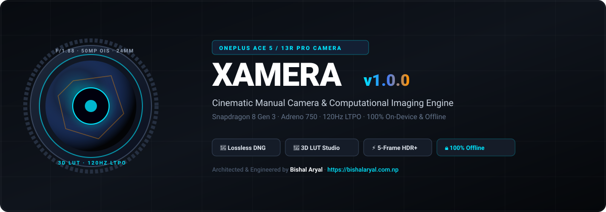
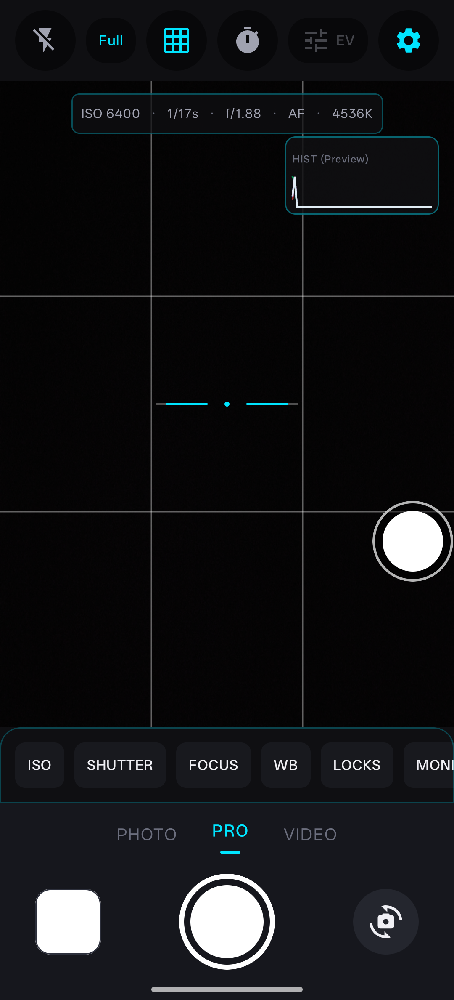
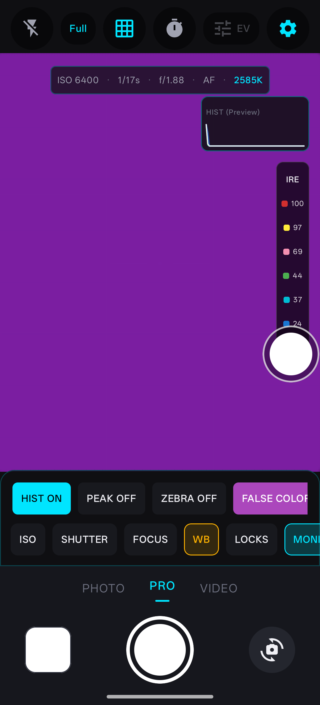
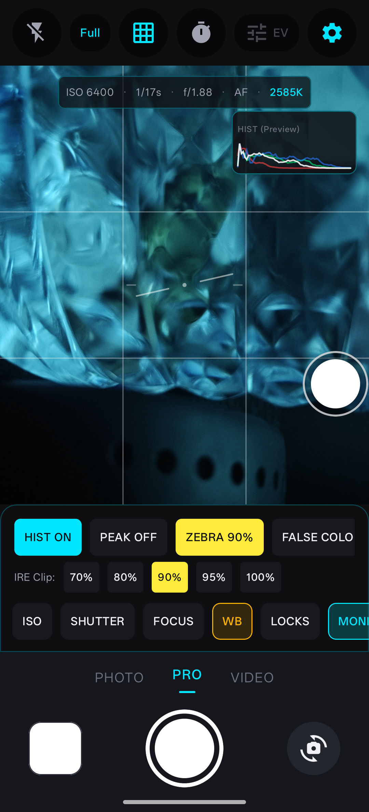
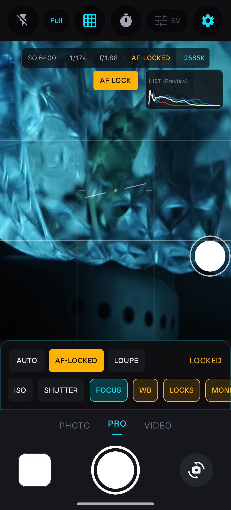
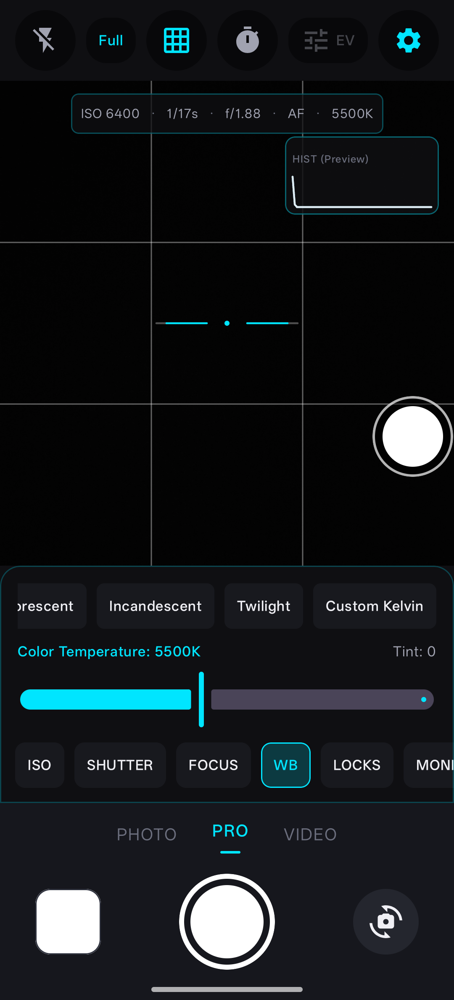
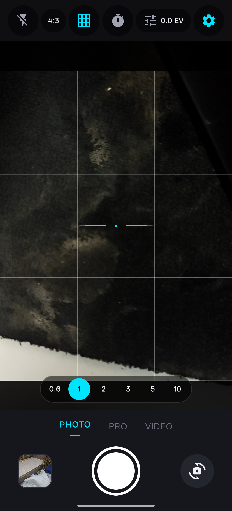

# Xamera (v1.0.0) — Professional Pro Camera & Computational Photography Engine
### The Ultimate OnePlus Ace 5 / OnePlus 13R Alternative Camera App

<p align="center">
  
</p>

<p align="center">
  <a href="https://github.com/arybishal/Xamera/releases/tag/v1.0.0"></a>
  <a href="https://android.com"></a>
  <a href="https://github.com/arybishal/Xamera"></a>
  <a href="https://github.com/arybishal/Xamera/blob/main/LICENSES.md"></a>
  <a href="https://bishalaryal.com.np"></a>
</p>

---

## 📸 What is Xamera?

**Xamera** is an open-source, offline-first, professional cinema and manual camera application engineered from the ground up to unlock the complete photographic and optical potential of modern Android flagships.

Specifically fine-tuned as an advanced **OnePlus Ace 5 (China) / OnePlus 13R (Global)** alternative camera app (`CPH2691IN` / `OP5D3BL1`, Qualcomm Snapdragon 8 Gen 3, Adreno 750, Android 17 API 37), Xamera eliminates artificial vendor processing limits, over-sharpening, and aggressive noise reduction in favor of:

- **Full Native Camera2 Manual Controls:** Nanosecond shutter speed, analog ISO, calibrated Kelvin white balance (2000K–10000K), and sub-pixel manual focus diopter adjustments.
- **Uncompressed RAW/DNG Capture:** Lossless 14-bit Adobe DNG files generated via native `DngCreator` pipeline with embedded sensor calibration matrix and lens shading profiles.
- **Real-Time 3D LUT Color Science Studio:** Live viewfinder grading and capture baking with custom `.cube` 3D Look-Up Tables (17x17x17, 33x33x33, 64x64x64 lattices) powered by OpenGL ES 3.0 shaders.
- **5-Frame HDR+ Radiance Fusion:** Handheld multi-frame exposure stacking with sub-pixel luminance projection alignment and dynamic motion ghost rejection.
- **Cinematic Creative Shaders:** Hardware-accelerated procedural film grain and photochemical halation highlight bloom.
- **120Hz LTPO Viewfinder Synchronization:** Fluid display pacing (< 8.5ms average frametime) decoupled from background capture pipelines.
- **100% On-Device & Private:** Zero network requests, zero telemetry, no cloud accounts, and built-in EXIF privacy scrubbing with Safe Sharing.

---

## 📱 Screenshots & User Interface

| Pro Manual Controls & Live Viewfinder | Real-Time False Color Heatmap | IRE Zebra Striping & Highlights |
|:---:|:---:|:---:|
|  |  |  |
| *Full manual ISO, shutter, Kelvin & histogram* | *Full-spectrum 16-zone exposure analysis* | *Active highlight clipping boundary warning* |

| Focus Assist Loupe (Magnifier) | Fine Kelvin & Tint Controls | Composition Grids & Horizon |
|:---:|:---:|:---:|
|  |  |  |
| *Real-time 2x–4x center zoom for manual focus* | *Blackbody Planckian locus chromatic gains* | *Rule of thirds, golden ratio & dual-axis level* |

---

## ⚡ Key Feature Highlights

### 🎯 1. Professional Photography & RAW Engine
- **Manual Exposure:** Granular ISO selection (ISO 50 to 6400) and physical shutter timing (1/8000s up to 30 seconds).
- **Manual Focus & Loupe:** Diopter control from macro (10.0 dpt) to infinity (0.0 dpt) with a real-time 2x–4x magnifying loupe.
- **Kelvin White Balance:** Fine continuous color temperature adjustments with green/magenta tint bias.
- **Histogram & Exposure Aids:** 4-channel real-time histogram (RGB + Luma), spatial focus peaking, 16-zone false color heatmap, and customizable IRE zebra striping (70%–100%).
- **Advanced Capture Modes:** Zero Shutter Lag (ZSL) circular buffer, Auto Exposure Bracketing (AEB), and RAW+JPEG dual-format output.

### 🎨 2. 3D LUT Color Science & Creative Shaders
- **5 Built-In Cinema Looks:** *Natural*, *Warm*, *Cool*, *Contrast*, and *Vintage* calibrated presets.
- **Import Custom `.cube` LUTs:** Import any standard DaVinci Resolve or Adobe Premiere 3D LUT file via Android SAF.
- **Photochemical Halation:** Simulates vintage film stock red-orange bloom spreading across intense specular light sources.
- **Organic Procedural Film Grain:** Simulates authentic silver-halide grain without static repeating textures.

### 🌌 3. Computational Photography & Portrait Mode
- **5-Frame HDR+ Fusion:** Multi-frame capture bracket combining underexposed shadow frames and highlight recovery frames into a clean high-dynamic-range photo.
- **Motion Rejection:** Automated block-based motion masking avoids ghosting artifacts from moving subjects.
- **Portrait Mode:** Studio-grade synthetic depth estimation with adjustable virtual aperture ($f/1.4$ to $f/5.6$) and 4 studio lighting styles (*Natural*, *Studio*, *Contour*, *Stage*).

### 🎬 4. Pro Video & Native MediaCodec Engine
- **High-Bitrate Recording:** 4K 24/30/60 FPS and 1080p 120 FPS high-speed recording up to 100 Mbps All-Intra.
- **Cinematic 180° Shutter Rule:** Automatic shutter speed pairing according to selected video framerate.
- **Audio Monitoring & Input Routing:** Real-time stereo VU peak meters, 3.5mm/USB-C external microphone detection, and Bluetooth headset input routing.
- **Video Export Studio:** On-device lossless trimming, PTS timestamp rebasing, and social media export presets (Reels, TikTok, YouTube Shorts, WhatsApp).

### 🛠️ 5. Hardware Intelligence & Ergonomics
- **Honest Optical Zoom:** Enforces the true 0.6x HAL minimum on the OnePlus Ace 5 / 13R ultra-wide module rather than misrepresenting it as 0.5x.
- **Hardware Thermal Monitor:** Reacts to Android `PowerManager` thermal status; automatically pauses heavy analytical overlays to prevent device overheating.
- **Left-Handed Ergonomic Mode:** Inverts the bottom control deck for comfortable one-handed left-thumb operation.
- **In-App Gallery & Safe Sharing:** Integrated MediaStore photo/video browser with DNG badge inspection, EXIF metadata viewer, and one-tap metadata-stripped Safe Sharing.

---

## 📥 How to Install

### Option A: Direct APK Install (Recommended)
1. Download the production-signed APK: **[`app-release.apk`](https://github.com/arybishal/Xamera/releases/download/v1.0.0/app-release.apk)**.
2. Open the downloaded APK on your Android device (OnePlus Ace 5, OnePlus 13R, or any compatible Android 10+ device).
3. If prompted, enable **"Install unknown apps"** in your device settings.
4. Tap **Install** and launch **Xamera**.

### Option B: Install via ADB (Android Debug Bridge)
Connect your phone via USB with USB Debugging enabled, then run:
```bash
adb install -r app-release.apk
```

---

## 🔒 Security & SHA-256 Checksum Verification

Verify the cryptographic integrity of the release APK before installing:

| File Name | Variant | SHA-256 Digest |
|---|---|---|
| **`app-release.apk`** | **Production-Signed (v1.0.0)** | `fdc2a4f0ef4350c82f99da3723ecd91a0ee8ff804b837f59d74b4b30ab6c91b9` |
| **`app-debug.apk`** | Developer Debug Build | `254b852da36e3aa893673f3e128c1d01c9610a93a87b9678b544bf4860ec2a36` |

### Verify on Windows (PowerShell):
```powershell
Get-FileHash -Algorithm SHA256 app-release.apk
```

### Verify on Linux / macOS (Terminal):
```bash
sha256sum app-release.apk
```

### Verify APK Certificate with `apksigner`:
```bash
apksigner verify --verbose --print-certs app-release.apk
```
*Expected Certificate SHA-256:* `9f8f225a433040bdc1a9c868dc6e07b4203571cd7e63806ab6b1cde1b4af5d2b`

---

## 🛠️ Technology Stack

| Layer | Technologies & Standards |
|---|---|
| **Language & Toolchain** | Kotlin 2.0.21, OpenJDK 17, Gradle 8.9 |
| **User Interface** | Jetpack Compose (BOM 2024.10.01), Material Design 3 |
| **Camera Frameworks** | CameraX 1.4.0 + Native Android Camera2 (`CameraDevice`, `DngCreator`) |
| **Shaders & GPU Compute** | OpenGL ES 3.0 / 3.2, EGL 1.4, GLSL ES 3.00 Shaders |
| **Video Encoding** | Native Android `MediaCodec` + `MediaMuxer` Hardware Subsystems |
| **Persistence & Database** | Room 2.6.1 + Jetpack Preferences DataStore |
| **Storage Architecture** | Android Scoped Storage (`MediaStore.Images` & `MediaStore.Video`) |

---

## 🏗️ Architecture & Documentation

Comprehensive architectural blueprints, hardware specs, and milestone reports are available in the repository:

- 📖 [ARCHITECTURE.md](ARCHITECTURE.md) — System architecture, unidirectional data flow, and session isolation.
- 📋 [FEATURE_REGISTRY.md](docs/FEATURE_REGISTRY.md) — Exhaustive inventory of all camera features, APIs, and verification states.
- 🛣️ [ROADMAP.md](ROADMAP.md) — Complete 16-phase engineering roadmap from inception to final release.
- 🛡️ [PRIVACY_SECURITY_AUDIT.md](docs/PRIVACY_SECURITY_AUDIT.md) — On-device privacy manifesto and permission audit.
- 📊 [DEVICE_COMPATIBILITY_MATRIX.md](docs/DEVICE_COMPATIBILITY_MATRIX.md) — OnePlus Ace 5 / 13R hardware analysis and platform tiers.
- 🔑 [PRODUCTION_SIGNING_GUIDE.md](docs/PRODUCTION_SIGNING_GUIDE.md) — Cryptographic release key specification and maintenance guide.
- 📄 [FINAL_RELEASE_REPORT.md](docs/reports/FINAL_RELEASE_REPORT.md) — Comprehensive v1.0.0 project handover report.

---

## 👤 Developer & Contact

* **Lead Architect & Developer:** Bishal Aryal
* **Portfolio & Website:** [https://bishalaryal.com.np](https://bishalaryal.com.np)
* **GitHub Profile:** [@arybishal](https://github.com/arybishal)
* **Repository:** [https://github.com/arybishal/Xamera](https://github.com/arybishal/Xamera)

---

## 📄 License

```
Copyright 2026 Bishal Aryal

Licensed under the Apache License, Version 2.0 (the "License");
you may not use this file except in compliance with the License.
You may obtain a copy of the License at

    http://www.apache.org/licenses/LICENSE-2.0

Unless required by applicable law or agreed to in writing, software
distributed under the License is distributed on an "AS IS" BASIS,
WITHOUT WARRANTIES OR CONDITIONS OF ANY KIND, either express or implied.
See the License for the specific language governing permissions and
limitations under the License.
```
