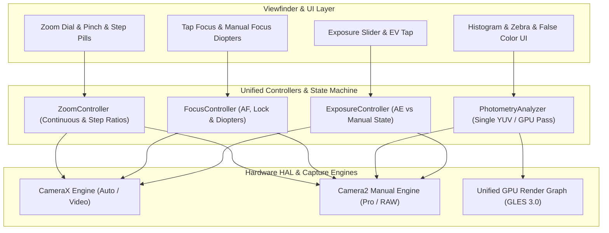
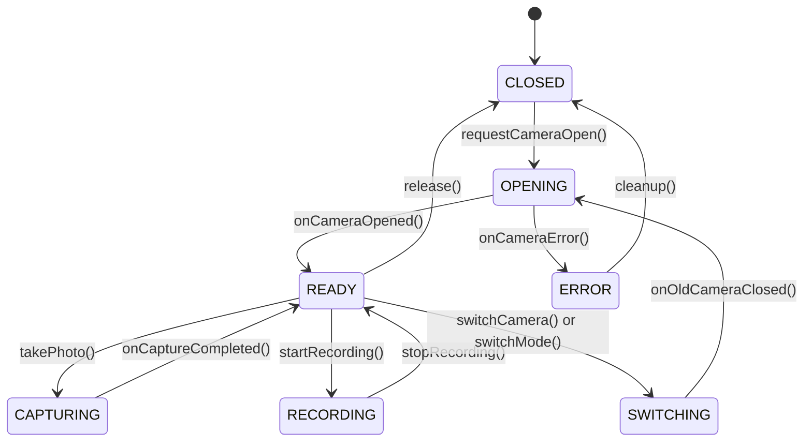

# Xamera Architecture Specification

**Project:** Xamera  
**Package:** `com.bishal.adaptivecamera`  
**Workspace:** `D:\Webapp\xamera`  
**Repository:** https://github.com/arybishal/Xamera  
**Developer:** Bishal Aryal  
**Version:** 0.5.1  
**Date:** 2026-11-06  

---

## 1. Architectural Philosophy: Hardware Intelligence First

Xamera is designed around **Hardware Intelligence First**:
- **Discovery Before Configuration:** Camera features are never statically assumed based on device marketing or vendor names. Instead, the Android `CameraManager` and `CameraCharacteristics` metadata are queried at runtime, parsed across 16 capability dimensions, and cached in a centralized `CameraCapabilityRepository`.
- **Strict Boundary Separation:** Hardware sessions and OpenGL rendering pipelines never run inside UI composables. State flows through unidirectional data flows (UDF) via Kotlin Coroutines and `StateFlow`.
- **Hybrid Camera Engine:**
  - **CameraX:** Serves as the robust, lifecycle-aware foundation for standard preview, standard photo, and standard video recording.
  - **Camera2:** Engaged when advanced manual sensor controls (explicit ISO / exposure time in nanoseconds), physical camera stream mapping, or RAW/DNG capture is required.
  - **Session Isolation:** An explicit finite state machine prevents CameraX and direct Camera2 sessions from competing for hardware control or leaking sensor allocations.

---

## 2. Package Architecture

```text
com.bishal.adaptivecamera
│
├── core/
│   ├── common/              # Common Result types, Dispatchers, Constants
│   ├── diagnostics/         # DeviceInfo, OEM detection, system telemetry, thermal monitor
│   ├── permissions/         # Camera and Audio permission handling
│   ├── settings/            # User settings management & DataStore
│   ├── storage/             # Scoped storage, MediaStoreManager, RAW vault
│   ├── sensors/             # Gyroscope & Accelerometer virtual horizon sensors
│   ├── haptics/             # System tactile haptic feedback engine
│   ├── peripherals/         # Bluetooth LE remote shutter & gimbal protocol handlers
│   └── lifecycle/           # Camera lifecycle observers & quick launch intents
│
├── camera/
│   ├── capability/          # CapabilityScanner, CapabilityProfile, Repository
│   ├── discovery/           # Camera device enumerator & hardware validator
│   ├── session/             # Session state machine (CLOSED, OPENING, READY, etc.)
│   ├── preview/             # Surface providers and viewfinder adapters
│   ├── capture/             # Photo capture dispatchers, ZSL ring buffer, AEB controller
│   └── controls/            # ExposureController, FocusController, ZoomController
│
├── intelligence/
│   ├── scene/               # Rule-based scene categorization (Portrait, Landscape, Night, etc.)
│   ├── analysis/            # Unified PhotometryAnalyzer (Histogram, Zebra, False Color)
│   ├── evaluator/           # Lighting and exposure evaluators
│   └── policies/            # Camera parameter & lens recommendation engines
│
├── photography/
│   ├── auto/                # Smart Auto orchestrator & suggestion chip
│   ├── pro/                 # Camera2ManualEngine, ISO/Shutter/Focus/Kelvin controllers
│   ├── raw/                 # RAW_SENSOR capture, DngCaptureManager, DngCreator
│   ├── hdr/                 # Multi-frame HDR fusion and de-ghosting
│   ├── night/               # Handheld night capture & astrophotography engines
│   └── processing/          # Watermarking, EXIF manager, bokeh renderer, focus stacking
│
├── video/
│   ├── recording/           # Pro video engine & recording coordinator
│   ├── profiles/            # Resolution, FPS, and bitrate validators
│   ├── encoder/             # MediaCodec video pipeline & GPU video encoder
│   ├── audio/               # Audio routing manager & real-time VU meter processor
│   ├── stabilization/       # OIS, EIS, and Super Steady coordinator
│   └── export/              # Embedded FFmpeg transcoding and export engine
│
├── lut/
│   ├── library/             # LUT repository and cache
│   ├── parser/              # .cube 3D LUT parser and numerical validator
│   ├── presets/             # Built-in presets (Natural, Warm, Cool, Contrast, Vintage)
│   ├── profiles/            # Log tone curves (Flat, S-Log/Log-C emulations)
│   └── database/            # Room database for user LUTs and metadata
│
├── graphics/
│   ├── egl/                 # EGLDisplay, EGLContext, EGLSurface lifecycle management
│   ├── opengl/              # OpenGL ES 3.0 shaders, programs, and 3D texture loaders
│   ├── shaders/             # LUT 3D, Film Grain, Halation, False Color shaders
│   └── framepipeline/       # Unified GPU render pipeline (OES to Viewfinder/Encoder)
│
├── gallery/
│   ├── media/               # MediaStore entity models & DNG metadata
│   ├── repository/          # Scoped gallery query repository
│   ├── viewer/              # Zoomable photo viewer & video player
│   └── export/              # DNG/JPEG export and share actions
│
└── ui/
    ├── camera/              # Main camera screen, viewfinder, pro controls
    │   ├── components/      # Viewfinder overlays, zoom dial, grids, level, shutter
    │   ├── pro/             # ProControlBar, HistogramView, FocusPeakingOverlay
    │   └── video/           # ProVideoControlBar, AudioVuMeterView
    ├── diagnostics/         # Hardware diagnostic inspection screen
    ├── settings/            # Dedicated settings & "Check Hardware Capability" screen
    ├── lut/                 # LUT selection drawer, slider, and comparison
    └── theme/               # Dark-first theme, colors, typography, haptics
```

---

## 3. Deduplication Architecture & Shared Pipelines

To prevent competing implementations, duplicate processing passes, and state conflicts, the system enforces single-controller contracts across all critical domains:



### 1. Exposure Architecture
- One `ExposureController`:
  - When in Auto / Video mode: `CONTROL_AE_MODE_ON` with dynamic hardware exposure compensation (`[-6, +6]` EV on the reference platform).
  - When in Manual / Pro mode: `CONTROL_AE_MODE_OFF`. Exposure is determined strictly by `SENSOR_SENSITIVITY` (ISO 100–6400) and `SENSOR_EXPOSURE_TIME` (78,120 ns to 74.35s).
  - UI exposure compensation sliders are locked/hidden in manual mode to prevent HAL rejection.

### 2. Photometry & Exposure Monitoring
- One `PhotometryAnalyzer`:
  - A single preview analysis stream (`ImageFormat.YUV_420_888`) or GPU fragment stage generates all photometric telemetry.
  - The 4-channel histogram (Luma, R, G, B) with 64 bins feeds both the waveform graph and highlight/shadow clipping detectors.
  - Live Zebra Striping (IRE 70%–100%) and Full-Spectrum False Color share this analysis without instantiating separate preview readers.

### 3. Focus & Lens Mechanics
- One `FocusController`:
  - Controls Autofocus (`CONTROL_AF_MODE_CONTINUOUS_PICTURE`), AF Lock (`CONTROL_AF_MODE_AUTO`), and Manual Focus (`CONTROL_AF_MODE_OFF` with `LENS_FOCUS_DISTANCE`).
  - Spatial Focus Peaking passively reads preview gradient edges without driving the lens actuator.
  - Focus Magnifier / Loupe applies a digital viewport crop on the preview texture without altering sensor crop.

### 4. Zoom & Lens Switching
- One `ZoomController`:
  - All input modalities (Pinch gesture, discrete step buttons, rotary zoom dial, and programmatic transitions) dispatch to `setZoomRatio(target)`.
  - Seamlessly arbitrates optical transitions between the 0.6x ultra-wide physical sub-sensor and the 1.0x wide main sensor.

### 5. RAW & Output Pipelines
- One `CapturePipeline`:
  - RAW-only (`DNG`), JPEG/HEIC-only, and RAW+JPEG/HEIC are capture configurations of a single `takePhoto()` dispatch.
  - Captures originate from synchronized `ImageReader` surfaces binding `ImageFormat.RAW_SENSOR` and `ImageFormat.JPEG`.

### 6. Color Science & GPU Shaders
- One `GpuRenderingPipeline`:
  - Unified OpenGL ES 3.0 render graph:
    `OES Camera Texture -> Color Space / Log Curve -> 3D LUT Sampling -> Film Grain -> Halation Glow -> Target (Preview / PBO / MediaCodec)`.
  - Avoids duplicate shader engines for photo preview, photo capture, and video recording.

### 7. Video Recording
- One `VideoRecordingConfiguration`:
  - Centralizes Resolution, FPS, Bitrate, Shutter Angle, Stabilization, and Audio Routing.
  - Time-lapse and Slow Motion are specialized capture/playback rate profiles operating inside this shared engine.

---

## 4. Session State Machine & Isolation

Camera access is arbitrated using an explicit finite state machine:



- When switching between Standard (CameraX) and Pro (Camera2), the previous engine's resources (`ProcessCameraProvider` or `CameraDevice` / `HandlerThread`) are cleanly closed before the new engine opens the hardware.
- Prevents HAL deadlock and "Camera in use" exceptions.

---

## 5. Unified GPU Render Graph

```text
Camera Hardware (Camera2 / CameraX)
            │
            ▼
   SurfaceTexture (OES Texture)
            │
            ▼
    OpenGL ES 3.0 Pipeline
   ┌────────────────────────────────────────────────────────┐
   │ 1. Log / Gamma Transfer Transform (Log profiles)       │
   │ 2. 3D Texture Sampling (Adobe .cube Trilinear Filter)   │
   │ 3. Uniform Intensity Mixing (0% - 100%)                │
   │ 4. Procedural Film Grain Shader (35mm / 16mm noise)    │
   │ 5. Photochemical Halation Glow Shader (Specular edge)  │
   └────────────────────────────────────────────────────────┘
            │
       ┌────┴───────────────────────────┬────────────────────────┐
       ▼                                ▼                        ▼
Screen Preview Surface       Encoder Input Surface     Capture Pixel Buffer
(EGLSurface for Viewfinder)  (MediaCodec Surface MP4)  (PBO / Bitmap for JPEG)
```

---

## 6. Security, Privacy & Compliance Guarantees

1. **Zero External Network Dependencies:** No cloud APIs, no remote telemetry, no external SDK trackers.
2. **100% On-Device Processing:** All RAW, DNG, JPEG, LUT, Video, AI Scene Classification, and Document/Barcode scanning execute strictly on-device using local CPU/GPU/NPU.
3. **Scoped Storage Compliance:** Media is saved strictly via Android `MediaStore` into `Pictures/AdaptiveCamera` and `Movies/AdaptiveCamera`. Private RAW vault captures remain non-indexed in isolated app storage.
4. **Privacy Metadata Management:** Optional "Strip EXIF" toggle strips GPS coordinates, device serial numbers, and sensitive metadata prior to file writing.
