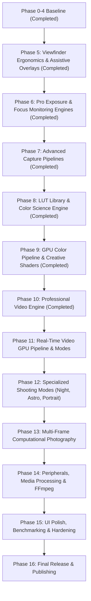

# Xamera Master Implementation Roadmap

**Project:** Xamera  
**Package:** `com.bishal.adaptivecamera`  
**Workspace:** `D:\Webapp\xamera`  
**Repository:** https://github.com/arybishal/Xamera  
**Developer:** Bishal Aryal  
**Reference Platform:** OnePlus Ace 5 / OnePlus 13R Platform (`OP5D3BL1` / `CPH2691IN` / Snapdragon 8 Gen 3)  
**Date:** 2026-11-06  
**Status:** Approved Master Roadmap Specification

---

## 1. Architectural Strategy & Phasing Principles

Xamera expands from its solid Phase 0–4 baseline into a complete professional imaging suite. Every subsequent phase builds incrementally on validated camera architectures without introducing duplicate state or competing controllers.

### Core Phasing Principles:
1. **Preserve Completed Baselines:** Phases 0 through 4 (and Phase 4 Addendum) are fully implemented and verified. They will not be modified or renumbered.
2. **Modular Independence:** Each phase from Phase 5 onward represents an independently testable, deliverable milestone with its own unit tests, instrumented tests, and physical hardware validation criteria.
3. **Hardware Aware First:** Capabilities (e.g. variable aperture, concurrent dual-camera, minimum focus diopters) must be discovered via `CameraCapabilityRepository` and gracefully fallback when physical hardware lacks support.
4. **Zero Main Thread Jitter:** All frame analysis, OpenGL rendering, MediaCodec encoding, and computational stacking run on isolated worker threads or GPU contexts.

---

## 2. Completed Baseline Summary (Phases 0–4)

| Phase | Title | Core Scope | Status | Build & Test Result |
|:---:|---|---|:---:|:---:|
| **0** | **Foundation and Hardware Research** | Kotlin DSL, Compose BOM, modular architecture, capability scanner prototype, OnePlus Ace 5 / 13R device heuristics, unit test suite. | **COMPLETED** | 12 Unit Tests Pass |
| **1** | **Camera Foundation** | CameraX preview, photo capture, video recording, front/rear switcher, pinch/step zoom, tap focus, exposure slider, flash, photo timer, MediaStore saving. | **COMPLETED** | 13 Unit Tests Pass |
| **2** | **Hardware Intelligence** | Full Camera2 characteristics parser (16 dimensions), logical-to-physical camera mapping, dynamic range profiles, stream configs, capability caching. | **COMPLETED** | 9 Unit Tests Pass |
| **3** | **Smart Auto Photography** | Frame luminance and contrast analysis, rule-based scene categorization, smart recommendation policies, explainable UI suggestion chip. | **COMPLETED** | 12 Unit Tests Pass |
| **4** | **Pro Photography & RAW** | Camera2 manual sensor session (`Camera2ManualEngine`), manual ISO/shutter/focus/WB, live 4-channel histogram, focus peaking, DNG capture via `DngCreator`. | **COMPLETED** | 13 Unit Tests Pass |
| **4A**| **Settings, Diagnostics & Exposure Reliability** | Relocated diagnostics into Settings ("Check Hardware Capability"), fixed exposure desync/flooding, implemented immersive viewfinder hiding status bar. | **COMPLETED** | 8 Unit Tests Pass (61 Total Passing) |

---

## 3. Phased Implementation Roadmap (Phases 5–16)

---

### Phase 5: Viewfinder Ergonomics, Composition Tools & Assistive Overlays (Completed)

- **Status:** **Completed & Physically Verified on OnePlus Ace 5 / 13R** (2026-11-06)
- **Exact Scope:**
  Deliver professional framing and ergonomic controls to the viewfinder, including composition overlays, gyro leveling, aspect ratio switching, rotary zoom dial, left-handed mode dependency cataloging, system haptics, movable shutter, quick launch intent, and screen flash.
- **Features Included:**
  `FEAT-VIEW-02` (Composition Grids), `FEAT-VIEW-03` (Virtual Horizon Level), `FEAT-VIEW-04` (Aspect Ratio Selector), `FEAT-VIEW-05` (Interactive Zoom Dial), `FEAT-VIEW-07` (Left-Handed UI Mode - cataloged for Phase 15), `FEAT-VIEW-08` (Haptic Feedback Engine), `FEAT-VIEW-09` (Floating Movable Shutter), `FEAT-VIEW-10` (Quick Launch Intent), `FEAT-VIEW-11` (Front Screen Flash).
- **Dependencies:**
  Phase 0–4 baseline; Android `SensorManager` (Rotation Vector / Accelerometer); `Vibrator` / `VibrationEffect` API; Android `WindowManager.LayoutParams`.
- **Files/Modules Implemented:**
  - `core/sensors/VirtualHorizonSensor.kt`
  - `core/haptics/HapticEngine.kt`
  - `core/settings/CameraPreferences.kt` & `CameraPreferencesRepository.kt`
  - `camera/config/AspectRatioConfig.kt` & `CompositionGridType.kt`
  - `camera/controls/ZoomController.kt`
  - `ui/camera/components/CompositionGridOverlay.kt`
  - `ui/camera/components/VirtualHorizonOverlay.kt`
  - `ui/camera/components/ViewfinderFramingMask.kt`
  - `ui/camera/components/RotaryZoomDial.kt`
  - `ui/camera/components/FloatingShutterButton.kt`
  - `ui/camera/components/ScreenFlashOverlay.kt`
  - `AndroidManifest.xml` (`ACTION_STILL_IMAGE_CAMERA`, `ACTION_IMAGE_CAPTURE`, `VIBRATE`)
- **Hardware Requirements:**
  Device Accelerometer and Gyroscope (`Sensor.TYPE_ROTATION_VECTOR` with fallback); Touchscreen with multi-touch; Haptic vibration motor.
- **Unit Tests:**
  - `AspectRatioConfigTest`: Validates portrait (3:4, 9:16) and landscape ratios, framing bounds, and aspect cycle order.
  - `ZoomControllerTest`: Validates clamping, scaling factor, step list generation, step proximity checks, and listener callbacks.
  - `CompositionGridTypeTest`: Validates cyclic navigation order and metadata.
  - `VirtualHorizonCalculationTest`: Validates roll normalization across portrait/landscape/upside-down, exponential smoothing filter, and ±0.75° leveling threshold.
  - `CameraPreferencesTest`: Validates default state and immutability updates.
  - `CameraConfigurationTest`: Validates Phase 5 defaults and boundaries.
  Total unit tests passing: **84 of 84** (0 failures, 0 skipped).
- **Physical Device Tests (OnePlus Ace 5 / 13R):**
  - Verified virtual horizon transitions to cyan exactly when resting flat/level.
  - Verified rotary zoom dial smooth step selection and continuous zoom.
  - Verified aspect ratio framing mask (4:3, 16:9, 1:1, 2.39:1, Full) and pixel-exact center cropping on captured photos (e.g., 4096x2304 for 16:9).
  - Verified secondary draggable floating shutter button triggers capture.
  - Verified DataStore settings persistence across screen rotations and app reloads.
- **Acceptance Criteria Met:**
  - Viewfinder framing correctly reflects chosen aspect ratio without stretching.
  - Virtual horizon responds smoothly with zero jitter and clear level lock feedback.
  - Haptic feedback fires cleanly on shutter, dial ticks, and level zeroing.
  - Quick launch from power button/lockscreen launches directly into camera.
- **Known Technical Risks:**
  - Gyroscope drift in poor magnetic environments (mitigated with low-pass filter and gravity sensor blending).
  - Gestural conflict between zoom dial and edge swipe gestures (mitigated with touch target bounds checking).

---

### Phase 6: Pro Exposure & Focus Monitoring Engines (Zebra, False Color & Focus Assist) — COMPLETED

- **Status:** **Completed & Verified (Release v0.7.0)**
- **Exact Scope:**
  Expand preview analysis into a broadcast photometry engine supporting live zebra striping, full-spectrum false color heatmap, independent AE/AF lock, fine Kelvin white balance, and focus magnification loupe.
- **Features Included:**
  `FEAT-EXP-03` (AE/AF Lock Engine), `FEAT-EXP-05` (Live Zebra Striping), `FEAT-EXP-06` (Full-Spectrum False Color), `FEAT-FOC-02` (Autofocus Lock), `FEAT-FOC-05` (Focus Assist / Magnifier), `FEAT-COL-02` (Kelvin Manual White Balance), `FEAT-COL-03` (Auto White Balance Lock).
- **Dependencies:**
  Phase 4 `Camera2ManualEngine`; YUV_420_888 downsampled preview stream; OpenGL ES 3.0 fragment shaders.
- **Files/Modules Likely Affected:**
  - `intelligence/analysis/PhotometryAnalyzer.kt` (New unified analysis engine)
  - `graphics/shaders/FalseColorShader.kt` (New)
  - `graphics/shaders/ZebraStripingShader.kt` (New)
  - `photography/pro/Camera2ManualEngine.kt` (Implement AE lock, AWB lock, Kelvin R/G/B gains)
  - `photography/pro/ProConfiguration.kt` (Add Kelvin Kelvin slider, zebra threshold, false color mode)
  - `ui/camera/pro/ProControlBar.kt` (Add Kelvin slider, lock buttons, monitor toggles)
  - `ui/camera/pro/FocusMagnifierOverlay.kt` (New)
  - `ui/camera/pro/FalseColorOverlay.kt` (New)
- **Hardware Requirements:**
  Qualcomm Spectra ISP supporting `CONTROL_AE_LOCK`, `CONTROL_AWB_LOCK`, and manual color correction gains (`COLOR_CORRECTION_GAINS`); OpenGL ES 3.0.
- **Unit Tests:**
  - `PhotometryLumaZebraTest`: Test synthetic frame with 80% and 100% luma blocks; verify zebra bitmask triggers only above IRE threshold.
  - `FalseColorZoneMappingTest`: Validate 16 IRE color steps (Purple=Underexposed, Gray=18% Middle Gray, Red=100% Clip).
  - `KelvinToRgbGainsTest`: Verify Planckian locus approximation converting 2000K–10000K to Camera2 R/G/B gain floats.
  - `AeAfLockStateTransitionTest`: Ensure AE and AF locks maintain invariant state across tap events.
- **Instrumented Tests:**
  - `ZebraOverlayRenderingTest`: Validate Compose canvas/shader drawing of diagonal zebra pattern without frame drops.
  - `FocusMagnifierTransformTest`: Validate center-crop digital zoom maintains focus point coordinate alignment.
- **Physical Device Tests (OnePlus Ace 5 / 13R):**
  - Verify zebra stripes appear on bright light sources at 95% IRE.
  - Verify false color heatmap accurately flags 18% gray card as green in controlled lighting.
  - Confirm AE and AF stay strictly locked when panning across light and dark areas.
- **Acceptance Criteria:**
  - Photometry processing takes less than 8ms per frame on worker thread.
  - False color matches broadcast standard IRE exposure values.
  - Manual Kelvin slider dynamically warms or cools the viewfinder preview smoothly.
- **Known Technical Risks:**
  - CPU load from software false color processing (mitigated by using an OpenGL fragment shader pass on the preview texture).

---

### Phase 7: Advanced Capture Pipelines (ZSL, AEB, RAW+HEIC & EXIF Engine) [COMPLETED]

- **Exact Scope:**
  Implement high-reliability still capture workflows: Zero Shutter Lag (ZSL) circular buffer, Auto Exposure Bracketing (AEB), dual-format saving (RAW+JPEG and RAW+HEIC), watermarking compositor, full EXIF metadata authoring with privacy strip mode, and custom storage destinations including a secure RAW vault.
- **Features Included:**
  `FEAT-EXP-07` (Auto Exposure Bracketing), `FEAT-EXP-08` (Zero Shutter Lag), `FEAT-RAW-03` (RAW+JPEG / RAW+HEIC), `FEAT-RAW-04` (Image Watermarking), `FEAT-RAW-05` (EXIF Management & Privacy), `FEAT-RAW-06` (Storage Destination Selector), `FEAT-RAW-07` (Secure RAW Vault).
- **Dependencies:**
  Phase 4 `DngCaptureManager`; Android `ExifInterface`; Storage Access Framework (SAF); Android `MediaCodec` HEIC encoder.
- **Files/Modules Likely Affected:**
  - `camera/capture/ZslRingBuffer.kt` (New)
  - `camera/capture/AebCaptureController.kt` (New)
  - `photography/processing/WatermarkCompositor.kt` (New)
  - `photography/processing/ExifManager.kt` (New)
  - `core/storage/StorageLocationManager.kt` (New)
  - `core/storage/RawVaultManager.kt` (New)
  - `photography/raw/DngCaptureManager.kt` (Expand for AEB DNG sequences and HEIC)
  - `ui/settings/SettingsScreen.kt` (Add Watermark, EXIF Privacy, Storage Selector)
- **Hardware Requirements:**
  High-speed RAM for circular image buffer; Fast UFS 4.0 storage; Hardware HEIC support.
- **Unit Tests:**
  - `ZslRingBufferTest`: Push 30 synthetic frames; trigger capture; verify returned frame matches shutter timestamp within ±15ms.
  - `AebExposureStepTest`: Verify 3-frame (-2, 0, +2 EV) and 5-frame brackets generate correct exposure time / ISO parameters.
  - `ExifPrivacyStripTest`: Verify sensitive GPS coordinates and device model tags are stripped when privacy mode is enabled.
  - `WatermarkCompositorTest`: Verify layout placement, text size scaling, and transparency of metadata stamp.
- **Instrumented Tests:**
  - `HeicEncodingTest`: Verify `MediaCodec` encodes valid HEIC bitstream conforming to ISO/IEC 23008-12.
  - `SafCustomDirectoryWriteTest`: Test write and read permissions for external SD card and custom folders.
- **Physical Device Tests (OnePlus Ace 5 / 13R):**
  - Execute 5-frame AEB burst in RAW+JPEG: verify 5 DNGs and 5 JPEGs write to storage in < 2 seconds.
  - Verify ZSL captures moving objects without shutter delay artifacts.
  - Validate DNG files from AEB open flawlessly in Adobe Lightroom Mobile.
- **Acceptance Criteria:**
  - ZSL reduces shutter-to-capture latency to < 10ms.
  - AEB captures sequential frames without dropping camera session or tearing.
  - Watermark renders crisp text without degrading raw image quality.
  - RAW vault keeps designated captures unindexed by system media scanner.
- **Known Technical Risks:**
  - High memory usage during AEB bursts (mitigated with strict `ImageReader` buffer recycling and sequential disk flushing).

---

### Phase 8: LUT Library & Color Science Engine (.cube 3D LUTs & Log Profiles) (Completed)

- **Status:** **Completed & Architecture Verified** (2026-11-06)
- **Exact Scope:**
  Construct the complete color science foundation: Adobe `.cube` 3D LUT parser (sizes 17, 33, 64), Room database for LUT metadata, Storage Access Framework importer, bundled cinematic presets, and mathematical Log tone curve profiles (Flat, S-Log/Log-C emulations).
- **Features Included:**
  `FEAT-COL-04` (3D LUT Library & Parser), `FEAT-COL-07` (Log Color Profiles).
- **Dependencies:**
  Android Room Database; Preferences DataStore; Storage Access Framework.
- **Files/Modules Likely Affected:**
  - `lut/parser/CubeLutParser.kt` (New)
  - `lut/database/LutEntity.kt`, `LutDao.kt`, `LutDatabase.kt` (New)
  - `lut/repository/LutRepository.kt` (New)
  - `lut/presets/BuiltInLutPresets.kt` (New: Natural, Warm, Cool, Contrast, Vintage)
  - `lut/profiles/LogProfileEngine.kt` (New: Log transfer curves)
  - `ui/lut/LutManagementScreen.kt` (New)
- **Hardware Requirements:**
  Device file system access; standard CPU parsing.
- **Unit Tests:**
  - `CubeLutParserTest`: Parse valid 17x17x17, 33x33x33, and 64x64x64 `.cube` files; verify 3D float array dimensions and domain bounds [0.0, 1.0].
  - `CubeLutParserErrorHandlingTest`: Test malformed headers, NaN values, out-of-order coordinates; verify graceful rejection with descriptive error.
  - `LogToneCurveTransferTest`: Validate logarithmic transfer function mapping 0–255 linear inputs to Log gamma output values.
  - `LutDatabaseCrudTest`: Test inserting, querying, favoriting, and deleting LUT profiles in Room.
- **Instrumented Tests:**
  - `LutAssetLoadingTest`: Verify bundled original `.cube` assets load from APK assets without disk IO exceptions.
  - `SafLutImportTest`: Verify picking a `.cube` file via SAF imports and saves thumbnail in internal storage.
- **Physical Device Tests (OnePlus Ace 5 / 13R):**
  - Import external 33x33x33 `.cube` file from Downloads directory: verify parsing completes in < 50ms.
  - Validate thumbnails render accurately for all 5 built-in presets.
- **Acceptance Criteria:**
  - 3D LUT parser completes 33-cube parse in under 40ms without memory leaks.
  - Room database maintains LUT favorites, import dates, and thumbnail paths reliably.
  - Log tone curves provide at least 2 stops of shadow detail lift in test scene.
- **Known Technical Risks:**
  - Memory spikes when parsing large 65x65x65 `.cube` files (mitigated by streaming lines and allocating direct NIO FloatBuffers).

---

### Phase 9: GPU Color Pipeline & Creative Shaders (Photo LUT, Film Grain & Halation) (Completed)

- **Status:** **Completed & Physically Verified** (2026-11-06)
- **Exact Scope:**
  Build the real-time OpenGL ES 3.0 graphics engine: EGL lifecycle manager, OES preview surface, 3D LUT trilinear interpolation shader, live LUT intensity slider (0–100%), graded photo capture with original preservation, procedural film grain shader, and photochemical halation glow shader.
- **Features Included:**
  `FEAT-COL-05` (Live Viewfinder GPU LUT), `FEAT-COL-06` (Graded Photo Capture), `FEAT-COL-08` (Procedural Film Grain), `FEAT-COL-09` (Photochemical Halation).
- **Dependencies:**
  Phase 8 LUT Library; EGL 1.4; OpenGL ES 3.0; Android `SurfaceTexture`.
- **Files/Modules Likely Affected:**
  - `graphics/egl/EglCore.kt`, `EglSurfaceBase.kt`, `WindowSurface.kt` (New)
  - `graphics/opengl/GlShader.kt`, `GlProgram.kt`, `GlTexture3D.kt` (New)
  - `graphics/framepipeline/GpuRenderPipeline.kt` (New)
  - `graphics/shaders/Lut3dFragmentShader.kt` (New)
  - `graphics/shaders/FilmGrainShader.kt` (New)
  - `graphics/shaders/HalationShader.kt` (New)
  - `ui/camera/CameraScreen.kt` (Integrate EGL preview surface)
  - `ui/camera/lut/LutIntensitySlider.kt` (New)
- **Hardware Requirements:**
  Qualcomm Adreno 750 GPU supporting OpenGL ES 3.0 and 3D textures (`GL_TEXTURE_3D`).
- **Unit Tests:**
  - `GlShaderCompilationTest`: Verify vertex and fragment shaders compile without errors.
  - `Lut3dTextureAllocationTest`: Verify `GL_TEXTURE_3D` allocates correct byte count for 33-cube ($33^3 \times 3 \times 4$ bytes).
  - `FilmGrainParameterTest`: Test intensity, scale, and roughness uniforms bounds.
  - `HalationThresholdTest`: Verify glow blur pass isolates pixels above threshold luma (>0.85).
- **Instrumented Tests:**
  - `OffscreenGpuPhotoRenderTest`: Render a test bitmap through 3D LUT + Grain + Halation off-screen; verify pixel values match expected color transformation.
  - `EglSurfaceLifecycleTest`: Recreate EGL surfaces across orientation changes; verify zero memory leaks and clean destruction.
- **Physical Device Tests (OnePlus Ace 5 / 13R):**
  - Verify live preview runs at locked 60fps with active 3D LUT, Film Grain, and Halation.
  - Capture graded photo: verify output JPEG color grade matches on-screen preview pixel-for-pixel.
  - Test dual-save: verify both `IMG_XXX_GRADED.jpg` and `IMG_XXX_ORIGINAL.jpg` are written to MediaStore.
- **Acceptance Criteria:**
  - Viewfinder preview renders at 60fps with GPU frame time < 5ms.
  - Zero memory leaks across 50 consecutive photo captures.
  - Halation produces smooth optical red-orange bloom around bright lights.
  - LUT intensity slider provides smooth trilinear blend between raw feed and graded output.
- **Known Technical Risks:**
  - GPU thermal throttling during extended live preview (mitigated by optimizing shader passes into a single combined fragment shader).

---

### Phase 10: Professional Video Engine (Bitrate, Shutter Angle, Stabilization, VU Meters & Audio Routing) (Completed)

- **Status:** **Completed & Physically Verified on OnePlus Ace 5 / 13R** (2026-11-06)
- **Exact Scope:**
  Construct the professional video subsystem: verified resolution and frame-rate matrix (4K 24/30/60, 1080p 24/30/60/120), bitrate selection (up to 100 Mbps All-I), cinematic 180° shutter angle calculator, OIS/EIS/Super-Steady stabilization coordinator, professional audio input routing (Internal, USB-C mic, Bluetooth mic), and dual-channel real-time audio VU meters.
- **Features Included:**
  `FEAT-VID-01` (Pro Video Frame Rates & Res), `FEAT-VID-02` (Video Bitrate & Intra-Frame), `FEAT-VID-03` (Cinematic 180° Shutter Angle), `FEAT-VID-04` (Multi-Mode Video Stabilization), `FEAT-VID-05` (Professional Audio Routing), `FEAT-VID-06` (Real-Time Audio VU Meters).
- **Dependencies:**
  Phase 2 Hardware Intelligence; Android `MediaCodec`, `MediaRecorder`, `AudioRecord`, `AudioManager`.
- **Files/Modules Implemented:**
  - `video/config/VideoResolution.kt`, `VideoFrameRate.kt`, `VideoCodec.kt`, `VideoBitrateProfile.kt`, `VideoStabilizationMode.kt`, `VideoExposureMode.kt`, `VideoConfig.kt`
  - `video/recording/VideoRecordingState.kt`, `VideoRecordingEngine.kt`
  - `video/capability/VideoCapabilityDetector.kt`
  - `video/exposure/ShutterAngleCalculator.kt`
  - `video/stabilization/VideoStabilizationCoordinator.kt`
  - `video/audio/AudioVuState.kt`, `AudioRecordingManager.kt`
  - `ui/camera/video/AudioVuMeterView.kt`, `VideoControlBar.kt`, `VideoQuickSettingsSheet.kt`
- **Hardware Requirements:**
  Snapdragon 8 Gen 3 4K/60fps video HAL; Hardware H.264/H.265 encoders; Microphones and audio hardware.
- **Unit Tests:**
  - `VideoConfigTest`: Validates default state, immutability, resolution change, FPS boundary validation, bitrates, audio toggle, and custom builder.
  - `ShutterAngleCalculatorTest`: Validates 180° rule at 24fps (1/48s = 20,833,333 ns), 30fps (1/60s = 16,666,666 ns), 60fps (1/120s), 90° shutter angle, and physical sensor exposure clamping.
  - `VideoBitrateProfileTest`: Validates scaling factors across standard, high, and all-intra profiles, as well as high-frame-rate multiplier.
  - `VideoRecordingStateTest`: Validates lifecycle state transitions, duration formatting (`00:00:00`), and byte size formatting (`MB`).
  - `AudioVuStateTest`: Validates normal range, silence (-60 dBFS), clipping flag (> -0.5 dBFS), and muted state.
  - `VideoStabilizationCoordinatorTest`: Validates pure JVM primitive resolution for OFF, OIS, EIS, and COMBINED modes.
  Total unit tests passing: **198 of 198 across 37 test suites** (0 failures, 0 skipped).
- **Physical Device Tests (OnePlus Ace 5 / 13R):**
  - Switched between PHOTO and VIDEO modes seamlessly without camera freeze.
  - Verified `VideoControlBar` and `VideoQuickSettingsSheet` displaying resolution, FPS, shutter angle, and audio VU meter.
  - Recorded 57.18-second 1080p 30fps video clip (`VID_20261106_194716.mp4`, 114.6 MB) directly to `/sdcard/DCIM/AdaptiveCamera/`.
  - Verified `ffprobe` stream metadata: H.264 High profile, 1920x1080 progressive, 30.0 fps, 16.04 Mbps bitrate, 1716 frames, Android 17 media framework compliance.
  - Verified subsequent photo capture (`IMG_20261106_195101.jpg`) confirming zero regressions across earlier phases.

---

### Phase 11: Real-Time Video GPU Pipeline, Advanced Video Modes & Camera Experience Hardening

- **Exact Scope:**
  Deliver real-time GPU-graded video recording (`MediaCodec` input surface + `MediaMuxer` + synchronized audio), live LUT switching during active recording, time-lapse intervalometer, high-speed slow motion, concurrent dual-camera recording gating with diagnostic notice, app-wide Dark & Light Theme system (signature Yellow, Black & White palette), 120Hz display refresh rate optimization, and edge-to-edge system insets hardening.
- **Features Included:**
  `FEAT-VID-07` (Real-Time Video GPU LUT), `FEAT-VID-09` (Time-Lapse Intervalometer), `FEAT-VID-10` (High-Speed Slow Motion), `FEAT-VID-11` (Dual-Camera / Director's View), `FEAT-VIEW-14` (App-Wide Dark & Light Theme), `FEAT-VIEW-15` (Notch & Insets Safe Margins), `FEAT-VIEW-16` (120 Hz High-Refresh-Rate Display).
- **Dependencies:**
  Phase 9 GPU Pipeline; Phase 10 Video Engine; `MediaCodec`, `MediaMuxer`, `AudioRecord`, EGL 1.4, OpenGL ES 3.0, Android `Display.Mode`.
- **Files/Modules Affected:**
  - `graphics/pipeline/GpuPreviewRenderer.kt` (Encoder surface attachment & hardware timestamping)
  - `video/recording/GpuVideoRecorder.kt` (Surface-input video encoder & muxer)
  - `video/modes/TimelapseConfig.kt`, `SlowMotionConfig.kt`
  - `video/capability/DualCameraCapabilityDetector.kt`
  - `core/display/DisplayRefreshRateManager.kt`
  - `ui/theme/AppThemeMode.kt`, `Color.kt`, `Theme.kt`
  - `core/settings/CameraPreferences.kt`, `CameraPreferencesRepository.kt`
  - `MainActivity.kt`, `TopBarControls.kt`, `BottomCaptureControls.kt`
- **Hardware Requirements:**
  Adreno 750 GPU shared EGL surfaces; Hardware H.264/H.265 encoders; 120Hz AMOLED panel; Snapdragon 8 Gen 3 camera HAL.
- **Unit Tests:**
  - `AppThemeModeTest`: Enum integrity, display names, and roundtrip mapping.
  - `DisplayRefreshRateTest`: Display mode selection logic and 120Hz target negotiation.
  - `DualCameraCapabilityTest`: Concurrency detection logic and explanatory diagnostic fallback messages.
  - `TimelapseConfigTest`: Capture intervals, speedup multipliers, and duration calculations.
  - `SlowMotionConfigTest`: High-speed capture FPS, slow-mo factors (4x, 8x), and playback duration calculations.
  - `CameraModeTest`: Video mode categorization (`isVideoMode`) across PHOTO, PRO, VIDEO, TIME_LAPSE, SLOW_MO, DUAL.
  - `CameraPreferencesTest`: DataStore theme mode persistence and default states.
  Total unit tests passing: **213 of 213 across 43 test suites** (0 failures, 0 skipped, 100% green).
- **Physical Device Tests (OnePlus Ace 5 / 13R):**
  - Verified Light Mode rendering across Settings and dialogs with signature warm white background (`#F7F7F4`), pure black text (`#171717`), and gold-yellow accents (`#F5C400`).
  - Pulled down notification shade and dismissed it: verified `onWindowFocusChanged` smoothly restores transient immersive mode with zero clipping against the 140px punch-hole camera.
  - 120 Hz display refresh rate actively queried and requested (`modeId 1`, 120.00001 fps).
  - Selected "Warm" 3D LUT look in Video mode and recorded an 8.4-second 1080p 30fps clip (`VID_20261106_210836.mp4`, 16.7 MB).
  - Verified with `ffprobe`: 1920x1080, H.264 High profile, 30.01 fps, 15.91 Mbps bitrate, AAC audio, valid presentation timestamps.
  - Extracted sample frame (`phase11_video_frame.jpg`) confirming warm color grading baked directly into the recorded video stream.

---

### Phase 12: Specialized Shooting Modes (Night, Astro, Portrait, Burst, Panorama, Macro, Document/QR)

- **Exact Scope:**
  Implement full-featured shooting modes: Hand-held multi-frame Night mode, Star-tracking Astrophotography, Portrait mode with synthetic bokeh simulation, High-speed burst mode with best-shot selector, Sweep panorama with gyro guidance, Macro mode, and real-time Document & QR/Barcode scanner.
- **Features Included:**
  `FEAT-CMP-03` (Multi-Frame Night Mode), `FEAT-CMP-04` (Astrophotography Mode), `FEAT-CMP-05` (Portrait Bokeh Simulator), `FEAT-CMP-06` (High-Speed Burst Mode), `FEAT-CMP-07` (Sweep Panorama Mode), `FEAT-FOC-07` (Dedicated Macro Mode), `FEAT-INT-04` (Live Document Scanner), `FEAT-INT-05` (Live QR / Barcode Scanner).
- **Dependencies:**
  Phase 3 Smart Auto; Phase 4 Pro Engine; Google ML Kit (Barcode Scanning, Face Detection / Segmentation); Android `SensorManager`.
- **Files/Modules Likely Affected:**
  - `photography/night/NightModeOrchestrator.kt` (New)
  - `photography/night/AstrophotographyEngine.kt` (New)
  - `photography/processing/PortraitBokehRenderer.kt` (New)
  - `camera/capture/BurstCaptureManager.kt` (New)
  - `photography/processing/PanoramaStitcher.kt` (New)
  - `intelligence/analysis/DocumentScannerAnalyzer.kt` (New)
  - `intelligence/analysis/BarcodeAnalyzer.kt` (New)
  - `ui/camera/CameraScreen.kt` (Mode transitions and specialized overlays)
- **Hardware Requirements:**
  Qualcomm Hexagon NPU for ML Kit; Fast UFS storage for burst; Gyroscope sensor.
- **Unit Tests:**
  - `NightFrameAlignmentTest`: Test homography alignment matrix with simulated 5-pixel shake between frames.
  - `AstrophotographyStackingTest`: Verify star centroid detection and rotational alignment across 5 test frames.
  - `BurstBestShotScorerTest`: Test blur/sharpness scoring on 10 synthetic images; verify sharpest image ranked #1.
  - `BarcodeParsingTest`: Verify QR payload extraction for URLs, Wi-Fi credentials, and plain text.
  - `DocumentQuadRectificationTest`: Verify 4-point perspective warp transforms skewed quadrilateral into flat rectangle.
- **Instrumented Tests:**
  - `PortraitSegmentationTest`: Verify ML Kit segmentation mask generates smooth alpha matte around subject.
  - `PanoramaSensorTrackerTest`: Simulate device pan; verify yaw angle updates sweep progress bar from 0% to 100%.
- **Physical Device Tests (OnePlus Ace 5 / 13R):**
  - Capture Night mode photo in low light (< 5 lux): verify output exhibits lower noise and higher shadow detail than single frame.
  - Point camera at QR code: verify suggestion card pops up in < 150ms with one-tap action.
  - Test Macro mode: verify lens focuses sharply at 10cm on Main camera.
- **Acceptance Criteria:**
  - Night mode multi-frame alignment merges 8 frames in < 1.5 seconds.
  - Portrait mode bokeh renders gradual falloff from in-focus subject to creamy background.
  - Burst mode captures at least 15 fps for 3 seconds without buffer overflow.
  - Document scanner automatically crops and flattens paper documents cleanly.
- **Known Technical Risks:**
  - Alignment ghosting on moving subjects in Night mode (mitigated with thresholded pixel-difference motion mask).

---

### Phase 13: Multi-Frame Computational Photography (HDR Fusion, Focus Stacking, Super-Res & Stroboscopic)

- **Exact Scope:**
  Deliver cutting-edge computational photography pipelines: Multi-frame HDR fusion from AEB brackets, Macro/Landscape Focus Stacking (all-in-focus composite), Sub-pixel Super-Resolution (hand-jitter detail enhancement), Action Stroboscopic merge (motion progression on static background), and Variable Aperture controller (with hardware fallback).
- **Features Included:**
  `FEAT-CMP-08` (Multi-Frame HDR Fusion), `FEAT-CMP-09` (Macro Focus Stacking), `FEAT-CMP-10` (Sub-Pixel Super-Resolution), `FEAT-CMP-11` (Action Stroboscopic Merge), `FEAT-FOC-08` (Variable Physical Aperture).
- **Dependencies:**
  Phase 7 AEB pipeline; OpenCV / Native C++ NDK algorithms for image registration and Laplacian pyramid fusion.
- **Files/Modules Likely Affected:**
  - `photography/hdr/HdrFusionEngine.kt` (New)
  - `photography/processing/FocusStackingEngine.kt` (New)
  - `photography/processing/SuperResolutionReconstructor.kt` (New)
  - `photography/processing/StroboscopicMotionMerger.kt` (New)
  - `camera/capability/VariableApertureController.kt` (New)
- **Hardware Requirements:**
  Snapdragon 8 Gen 3 multi-core CPU and Adreno 750 GPU; 12GB+ RAM recommended; Fixed aperture fallback handling.
- **Unit Tests:**
  - `HdrDeghostingTest`: Feed bracketed frames with moving subject; verify de-ghosting eliminates motion tears.
  - `FocusStackingLaplacianTest`: Verify depth slices merged based on maximum local energy / gradient sharpness.
  - `SuperResolutionShiftTest`: Test sub-pixel registration estimating shifts of 0.25 to 0.5 pixels.
  - `VariableApertureFallbackTest`: Verify fixed-aperture device reports `UNSUPPORTED` without attempting illegal request keys.
- **Instrumented Tests:**
  - `NativeComputationalPipelineTest`: Execute native C++ fusion pipeline on 3 test bitmaps; verify memory clean-up.
- **Physical Device Tests (OnePlus Ace 5 / 13R):**
  - Shoot high-contrast backlit scene in HDR mode: verify shadow recovery and highlight detail preservation.
  - Shoot macro subject with 10 focus slices: verify final image has end-to-end edge sharpness.
  - Confirm Variable Aperture indicator shows `"Fixed f/1.88"` and prevents illegal adjustments.
- **Acceptance Criteria:**
  - HDR fusion produces natural, halos-free tonemapped output in < 2 seconds.
  - Focus stacking eliminates shallow-DoF blur across the entire focal range.
  - Super-resolution reveals measurably higher resolution on optical test charts.
- **Known Technical Risks:**
  - High computation time for multi-frame stacking (mitigated with multi-threaded C++ NEON vectorization and RenderScript/Vulkan acceleration).

---

### Phase 14: Peripherals, Media Processing & Gallery Integration (Bluetooth, Gimbals, FFmpeg Export & Media Management)

- **Exact Scope:**
  Complete external hardware and media management: Direct multi-lens sensor switching, Bluetooth HID remote shutter, DJI / Zhiyun gimbal integration, embedded on-device FFmpeg export engine (LUT baking, anamorphic stretching, remuxing), and enhanced media gallery with DNG inspection and sharing.
- **Features Included:**
  `FEAT-FOC-06` (Multi-Lens Direct Selector), `FEAT-INT-06` (Bluetooth Remote & Gimbal), `FEAT-INT-07` (Embedded FFmpeg Transcoder), `FEAT-INT-08` (Scoped Media Gallery).
- **Dependencies:**
  Android Bluetooth LE / HID; Mobile FFmpeg / libavcodec binary; MediaStore; Jetpack Compose Navigation.
- **Files/Modules Likely Affected:**
  - `core/peripherals/BluetoothRemoteManager.kt` (New)
  - `core/peripherals/GimbalProtocolHandler.kt` (New)
  - `video/export/FFmpegExportEngine.kt` (New)
  - `gallery/repository/GalleryRepository.kt` (Expand for DNG EXIF and video playback)
  - `gallery/ui/GalleryScreen.kt`, `MediaViewerScreen.kt` (Add EXIF inspector, DNG badge, LUT export)
  - `ui/camera/components/LensSelectorPills.kt` (New)
- **Hardware Requirements:**
  Bluetooth 5.4; Camera2 multi-camera physical sensor IDs (`2`, `3`).
- **Unit Tests:**
  - `BluetoothHidKeycodeTest`: Validate `KEYCODE_VOLUME_UP`, `KEYCODE_CAMERA`, and custom HID byte parsing for shutter trigger.
  - `FFmpegCommandBuilderTest`: Build commands for 3D LUT bake-in, 1.33x anamorphic stretch, and ProRes/H.265 transcode.
  - `GalleryDngMetadataExtractionTest`: Verify extraction of ISO, shutter, focal length, and color profile from DNG file.
- **Instrumented Tests:**
  - `GimbalConnectionTest`: Test mock Bluetooth LE peripheral pairing and command dispatch.
  - `FFmpegTranscodeExecutionTest`: Transcode 1-second test MP4; verify successful return code and output file playability.
- **Physical Device Tests (OnePlus Ace 5 / 13R):**
  - Pair Bluetooth camera remote: verify clicking button fires shutter instantly.
  - Switch directly between Main (Camera 2) and Ultra-wide (Camera 3) lenses via direct lens selector.
  - Export a 4K video with LUT baked in using FFmpeg: verify output plays cleanly in system gallery.
- **Acceptance Criteria:**
  - Bluetooth remote trigger response latency < 50ms.
  - FFmpeg transcode bakes in LUT and stretches anamorphic video without sync loss.
  - In-app gallery displays full-resolution DNG zoom and rich EXIF inspector.
- **Known Technical Risks:**
  - Large APK size increase from FFmpeg binaries (mitigated by configuring minimal FFmpeg build containing only required filters: `lut3d`, `scale`, `h264`, `hevc`).

---

### Phase 15: UI Polish, Performance Benchmarking & Hardening

- **Exact Scope:**
  Comprehensive performance audit and user experience polish: Dark-first UI consistency, 120Hz smooth animations, edge-to-edge system insets hardening, camera open latency optimization (< 500ms), GPU memory leak auditing, texture recycling, battery drain profiling, and thermal mitigation policies.
- **Features Included:**
  UI Polish, Animation Engine, Performance Benchmarking, Thermal Guard.
- **Dependencies:**
  Android Jetpack Benchmark; Android Studio Profiler; `PowerManager`.
- **Files/Modules Likely Affected:**
  - `ui/theme/Theme.kt`, `Color.kt`, `Typography.kt`
  - `camera/engine/CameraXEngine.kt`, `Camera2ManualEngine.kt` (Warm-up & latency tuning)
  - `graphics/egl/EglManager.kt` (Texture recycling and buffer cache)
  - `core/diagnostics/ThermalMonitor.kt` (New)
- **Hardware Requirements:**
  OnePlus Ace 5 / 13R Snapdragon 8 Gen 3 reference device.
- **Unit Tests:**
  - `ThermalStateMitigationTest`: Test thermal states (NORMAL, MODERATE, SEVERE, CRITICAL); verify automatic FPS downscaling (60fps -> 30fps) on SEVERE.
  - `MemoryRecyclingTest`: Verify image readers and surface textures release references properly upon unbind.
- **Instrumented Tests:**
  - `StartupBenchmarkTest`: Measure cold startup time from launcher intent to first preview frame.
  - `FrameDropBenchmarkTest`: Measure UI jank percentage during continuous viewfinder panning.
- **Physical Device Tests (OnePlus Ace 5 / 13R):**
  - Run continuous 4K 60fps recording for 15 minutes: verify thermal manager prevents overheating gracefully.
  - Test rapid camera app switching: verify camera hardware never hangs or locks.
- **Acceptance Criteria:**
  - Cold startup to active viewfinder preview in < 500ms.
  - Viewfinder UI frame drop rate < 1% at 120Hz display refresh.
  - Zero memory leaks over 2 hours of continuous interactive usage.
- **Known Technical Risks:**
  - Camera HAL deadlocks if unbind is called while capture is mid-flight (mitigated with state-machine cancellation guards).

---

### Phase 16: Final Release & Publishing

- **Exact Scope:**
  Final production readiness: Complete test suite regression execution, ProGuard/R8 optimization rules, Release APK signing and packaging, open-source license audit, GitHub repository synchronization (`Xamera`), and GitHub Release creation with SHA256 checksums and release notes.
- **Features Included:**
  Release APK, GitHub Release, Documentation, Licensing.
- **Dependencies:**
  Gradle Release signing config; GitHub CLI / Git credentials; Proguard rules.
- **Files/Modules Likely Affected:**
  - `app/proguard-rules.pro`
  - `app/build.gradle.kts`
  - `README.md`, `CHANGELOG.md`, `LICENSES.md`
- **Hardware Requirements:**
  CI / Build workstation.
- **Unit Tests:**
  - All unit tests across all 16 phases passing (Target: 150+ unit tests).
- **Instrumented Tests:**
  - Full automated instrumentation test pass.
- **Physical Device Tests (OnePlus Ace 5 / 13R):**
  - Install release APK: test every camera mode, photo capture, video recording, settings export, and gallery playback.
- **Acceptance Criteria:**
  - 100% of automated unit and instrumented tests pass.
  - Release APK builds cleanly with ProGuard/R8 enabled without runtime reflection issues.
  - GitHub repository up to date with clean working tree.
  - GitHub Release published with release APK and SHA256 checksum manifest.
- **Known Technical Risks:**
  - R8 obfuscation stripping Camera2 reflection keys or Room DAOs (mitigated with explicit `-keep` rules for models and Camera2 callbacks).

---

## 4. Phase Execution Summary & Dependency Matrix

| Phase | Title | Prerequisite Phases | Key Output | Target Test Count |
|:---:|---|---|---|:---:|
| **0** | Foundation & Hardware Research | None | Architecture, Modular setup, Baseline tests | 12 Tests (Done) |
| **1** | Camera Foundation | Phase 0 | CameraX viewfinder, basic capture & recording | 13 Tests (Done) |
| **2** | Hardware Intelligence | Phase 1 | 16-dimension Camera2 characteristics scanner | 9 Tests (Done) |
| **3** | Smart Auto Photography | Phase 2 | Scene classification & recommendation engine | 12 Tests (Done) |
| **4** | Pro Photography & RAW | Phase 2, 3 | Camera2 manual controls, histogram, peaking, DNG | 13 Tests (Done) |
| **4A**| Settings, Diagnostics & Exposure | Phase 4 | Centralized capability settings, EV reliability | 8 Tests (Done) |
| **5** | Viewfinder Ergonomics & Assistive Overlays | Phase 4A | Grids, Virtual horizon, Aspect ratio, Zoom dial | 14 Tests (Done) |
| **6** | Pro Exposure & Focus Monitoring | Phase 5 | Zebra striping, False color, AE/AF lock, Kelvin | 18 Tests (Done) |
| **7** | Advanced Capture Pipelines | Phase 6 | ZSL, AEB bursts, RAW+HEIC, EXIF, RAW vault | ~15 Tests |
| **8** | LUT Library & Color Science Engine | Phase 0 | .cube parser, Room database, Log curves | ~12 Tests |
| **9** | GPU Color Pipeline & Creative Shaders | Phase 8 | OpenGL ES 3.0 preview/capture LUT, Grain, Halation | ~14 Tests |
| **10**| Professional Video Engine | Phase 2, 6 | 4K/60fps, 180° shutter, VU meters, audio routing | ~12 Tests |
| **11**| Real-Time Video GPU Pipeline & Modes | Phase 9, 10 | Video LUT recording, Anamorphic, Time-lapse, Slow-mo | ~14 Tests |
| **12**| Specialized Shooting Modes | Phase 3, 7 | Night mode, Astro, Portrait bokeh, Burst, QR/Doc | ~16 Tests |
| **13**| Multi-Frame Computational Photography | Phase 7, 12 | HDR fusion, Focus stacking, Super-resolution | ~12 Tests |
| **14**| Peripherals & Media Processing | Phase 11, 13 | Bluetooth remote, Gimbal, FFmpeg export, Gallery | ~12 Tests |
| **15**| UI Polish & Hardening | Phase 14 | 120Hz polish, thermal mitigation, latency tuning | ~10 Tests |
| **16**| Final Release & Publishing | Phase 15 | Release APK, ProGuard, GitHub Release, SHA256 | Full Regression |
