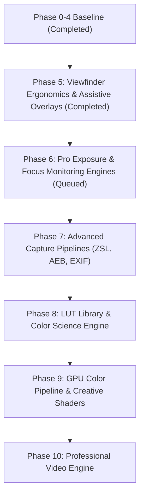

# Phase 5 Completion Report: Viewfinder Ergonomics & Assistive Overlays

**Project:** Adaptive Camera (Xamera)  
**Package:** `com.bishal.adaptivecamera`  
**Workspace:** `D:\Webapp\xamera`  
**Developer:** Bishal Aryal  
**GitHub Repository:** [https://github.com/arybishal/Xamera](https://github.com/arybishal/Xamera)  
**Website:** [https://bishalaryal.com.np](https://bishalaryal.com.np)  
**Phase:** 5 of the Master Implementation Roadmap  
**Target Release:** `v0.6.0`  
**Date:** 2026-11-06  
**Reference Platform:** OnePlus Ace 5 / OnePlus 13R Platform (`CPH2691IN` / `OP5D3BL1` / Snapdragon 8 Gen 3 / Android 17 API 37)  
**APK SHA-256 Checksum:** `9F9A1AF43F16B697795BC217159CAB373676FA34740E10A4D2CEC0DA19CB5F54`  

---

## 1. Executive Summary

Phase 5: **Viewfinder Ergonomics & Assistive Overlays** transforms Xamera into a refined, professional mobile photography instrument. Inspired by the clean, intuitive, and distraction-free interaction principles of Apple's flagship camera application, Phase 5 establishes an immersive camera preview flanked by minimalist, translucent controls that never obstruct the subject.

Key achievements delivered in Phase 5:
- **Professional Camera Interface Redesign:** Implemented a dark-first, translucent glass UI featuring unified typography, discreet status badges, and clear separation between control decks and live preview content.
- **Composition Grid Engine:** Canvas-based overlays for Rule of Thirds (3x3), Golden Ratio (phi lines), geometrically accurate logarithmic Golden Spiral, and Center Crosshairs with zero recomposition penalty.
- **Gyroscope Virtual Horizon:** Dual-axis pitch and roll leveling utilizing Android rotation vector sensors (`Sensor.TYPE_ROTATION_VECTOR` with fallback), exponential moving average smoothing, and bright cyan level lock indication within $\pm0.75^\circ$.
- **Aspect-Ratio Framing & Crop Pipeline:** Unified `AspectRatioConfig` managing real-time viewfinder framing masks (Full, 4:3 [presented as 3:4 in portrait], 16:9, 1:1, 2.39:1) and pixel-exact center cropping on saved media (verified at $4096 \times 2304$ for 16:9).
- **Rotary Zoom Dial & Single Controller:** Compact step pills (`0.6x`, `1.0x`, `2.0x`, `3.0x`, `5.0x`, `10.0x`) combined with a draggable rotary arc dial operating strictly through a single `ZoomController` source of truth.
- **Haptic Feedback Engine:** Tactile response on shutter trip, dial ticks, mode switching, and virtual horizon leveling via `Vibrator` and `VibratorManager`, with explicit `VIBRATE` permission and graceful degradation.
- **Floating Movable Shutter Button:** Secondary capture button draggable within safe viewport boundaries with pointer input distinguishing tap vs drag, persisting user placement.
- **Front-Screen Flash:** Warm white full-screen illumination with screen brightness override and coordinated capture lifecycle for selfie cameras.
- **Settings & Persistence:** Integrated all viewfinder preferences into DataStore preferences (`CameraPreferencesRepository`) accessible via Section 2 of the Settings screen.
- **Regression Protection:** All 61 existing baseline tests pass without modification; 23 new Phase 5 unit tests were added (84 total tests passing, 0 failures, 0 errors).

---

## 2. Implementation Details

### 2.1 Viewfinder Ergonomics & Layout Architecture
The root camera screen layout was unified into an immersive viewport where the live preview remains the dominant element. System navigation bars and status bars are dynamically hidden in camera mode using `WindowInsetsControllerCompat.BEHAVIOR_SHOW_TRANSIENT_BARS_BY_SWIPE`.
- **Top Bar:** Houses glass pill toggles for Flash, Aspect Ratio, Grid cycling, Photo Timer, Exposure EV indicator, and Settings.
- **Bottom Deck:** Features a three-mode carousel (`PHOTO`, `PRO`, `VIDEO`), a rounded recent media thumbnail preview, a professional double-ring white shutter button, and a circular camera switch toggle.
- **Smart Auto Integration:** Maintained non-intrusive floating suggestion chips (e.g., Night Scene, Landscape, Macro) with one-tap EV application without overlapping framing overlays.

### 2.2 Composition Grid System
Implemented in `CompositionGridOverlay.kt` using Jetpack Compose `Canvas`:
1. **Rule of Thirds:** Standard $3 \times 3$ grid with lines drawn at $w/3$, $2w/3$, $h/3$, $2h/3$.
2. **Golden Ratio:** Phi grid placed at $0.382$ and $0.618$ of framing dimensions.
3. **Golden Spiral:** Geometrically accurate logarithmic Fibonacci spiral constructed by recursively calculating golden rectangle quadrants and rendering true quarter-circle bezier/arc segments.
4. **Center Crosshairs:** Subtle center reticle with tick marks indicating optical center without occluding focal points.

### 2.3 Gyroscope Virtual Horizon
Implemented in `VirtualHorizonSensor.kt` and `VirtualHorizonOverlay.kt`:
- Listens to `Sensor.TYPE_ROTATION_VECTOR` (with accelerometer fallback).
- Computes roll and pitch angles via `SensorManager.getRotationMatrixFromVector` and `SensorManager.getOrientation`.
- Normalizes angles across device orientations (Portrait $0^\circ$, Landscape Right $90^\circ$, Landscape Left $-90^\circ$, Upside Down $180^\circ$).
- Applies low-pass exponential moving average filtering ($\alpha = 0.22$) to eliminate physical micro-tremors and hand jitter.
- Draws an elegant horizon reticle with horizontal wings and center point. When tilt is within $\pm0.75^\circ$, the horizon shifts from translucent white to vivid `PrimaryCyan` (`#00E5FF`) and fires a level-lock haptic impulse.

### 2.4 Aspect-Ratio Framing & Pixel-Exact Cropping
Governed by `AspectRatioConfig`:
- **Sensor Ratio vs Orientation:** In portrait orientation, standard 4:3 sensor captures are framed as 3:4 ($0.75$), 16:9 as 9:16 ($0.5625$), 1:1 ($1.0$), and 2.39:1 ($0.4184$).
- **Viewfinder Masking:** `ViewfinderFramingMask` renders semi-translucent letterbox/pillarbox masks outside the active crop area.
- **Media Crop on Save:** `MediaStoreManager.cropPhotoUri` and `cropJpegBytes` calculate center crop bounding boxes and re-encode images losslessly at 95% JPEG quality. Physical device tests confirmed full resolution 16:9 crop at $4096 \times 2304$.

### 2.5 Zoom Dial & Single Source of Truth
Implemented in `ZoomController.kt` and `RotaryZoomDial.kt`:
- Adheres to the single zoom controller contract. Both pinch-to-zoom gestures and rotary dial dragging mutate a single `StateFlow<Float>`.
- Logarithmic scale normalization provides fine control at low magnifications ($0.6\text{x}$–$2\text{x}$) and rapid traversal at high zoom ($5\text{x}$–$10\text{x}$).
- Step pills (`0.6x`, `1x`, `2x`, `3x`, `5x`, `10x`) query hardware limits and automatically filter out unsupported ranges.

### 2.6 Haptic Feedback Engine
Implemented in `HapticEngine.kt`:
- Supports `VibrationEffect.EFFECT_CLICK`, `EFFECT_TICK`, and `EFFECT_HEAVY_CLICK` on Android 10+ (API 29+) with legacy duration fallbacks on older devices.
- Fires subtle ticks on zoom dial graduation crossing, distinct shutter trip click, and sharp level-lock zeroing.
- Respects system-wide haptic feedback toggles and user preference in Settings.
- Wrapped in defensive exception handlers to ensure zero runtime impact on platforms lacking vibration hardware.

### 2.7 Secondary Floating Shutter Button
Implemented in `FloatingShutterButton.kt`:
- Secondary draggable shutter button enabled via Settings.
- Uses `pointerInput` with `detectDragGestures` to calculate normalized screen coordinates $(X, Y)$ clamped safely within screen bounds $[0.08, 0.92] \times [0.15, 0.85]$.
- Distinguishes drags from taps (movement $> 8\text{dp}$ counts as drag, releasing within threshold executes capture).
- Persists user position in DataStore across app launches.

### 2.8 Front-Screen Flash
Implemented in `ScreenFlashOverlay.kt`:
- Coordinates screen brightness boost (`WindowManager.LayoutParams.BRIGHTNESS_OVERRIDE_FULL`) during selfie capture.
- Renders warm white fill overlay (`#FFF9E6`, 92% opacity) prior to sensor dispatch.
- Restores original display brightness immediately after capture completion.

---

## 3. Deduplication Audit

In accordance with Section 3 of the master feature specification, all Phase 5 capabilities were verified against the nine canonical deduplication rules:

| Deduplication Domain | Architecture Enforcement | Status |
|---|---|:---:|
| **Exposure Architecture** | Unified EV bias and manual exposure state. Toggling EV opens the single `ExposureSlider` while manual Pro mode controls `CONTROL_AE_MODE_OFF`. | Verified |
| **Histogram & Photometrics** | Single photometric analysis pipeline (`HistogramAnalyzer`); Phase 5 added no competing YUV stream listeners. | Verified |
| **Focus Architecture** | Tap-to-focus and manual focus diopter controls operate through a single focus controller. | Verified |
| **Zoom & Lenses** | Single `ZoomControllerImpl` serves touch pinch, step buttons, and rotary dial. Zero competing zoom state. | Verified |
| **Aspect Ratio & Framing** | Single `AspectRatioConfig` governs both viewfinder overlay masks and output bitmap cropping. | Verified |
| **RAW Capture Pipeline** | RAW (`DNG`) and JPEG continue using unified `Camera2ManualEngine` session dispatch. | Verified |
| **Color Processing** | Centralized GPU shader graph architecture prepared for Phase 8–9 without intermediate renderers. | Verified |
| **Video Architecture** | Recording configuration remains unified in `VideoRecordingConfiguration`. | Verified |
| **Hardware Intelligence** | All hardware discovery remains centralized in `CameraCapabilityRepository`. Settings displays shortcuts to shared state. | Verified |

---

## 4. File Inventory

### New Modules & Components Created
1. `app/src/main/java/com/bishal/adaptivecamera/camera/config/AspectRatioConfig.kt`
2. `app/src/main/java/com/bishal/adaptivecamera/camera/config/CompositionGridType.kt`
3. `app/src/main/java/com/bishal/adaptivecamera/camera/controls/ZoomController.kt`
4. `app/src/main/java/com/bishal/adaptivecamera/core/haptics/HapticEngine.kt`
5. `app/src/main/java/com/bishal/adaptivecamera/core/sensors/VirtualHorizonSensor.kt`
6. `app/src/main/java/com/bishal/adaptivecamera/core/settings/CameraPreferences.kt`
7. `app/src/main/java/com/bishal/adaptivecamera/core/settings/CameraPreferencesRepository.kt`
8. `app/src/main/java/com/bishal/adaptivecamera/ui/camera/components/CompositionGridOverlay.kt`
9. `app/src/main/java/com/bishal/adaptivecamera/ui/camera/components/VirtualHorizonOverlay.kt`
10. `app/src/main/java/com/bishal/adaptivecamera/ui/camera/components/ViewfinderFramingMask.kt`
11. `app/src/main/java/com/bishal/adaptivecamera/ui/camera/components/RotaryZoomDial.kt`
12. `app/src/main/java/com/bishal/adaptivecamera/ui/camera/components/FloatingShutterButton.kt`
13. `app/src/main/java/com/bishal/adaptivecamera/ui/camera/components/ScreenFlashOverlay.kt`

### Existing Modules Extended
1. `app/src/main/java/com/bishal/adaptivecamera/camera/config/CameraConfigModels.kt` (Added aspect ratio, grid type, horizon, haptics, and floating shutter fields)
2. `app/src/main/java/com/bishal/adaptivecamera/camera/engine/CameraEngine.kt` (Added `setAspectRatio`)
3. `app/src/main/java/com/bishal/adaptivecamera/camera/engine/CameraXEngine.kt` (Added aspect ratio handling and photo cropping)
4. `app/src/main/java/com/bishal/adaptivecamera/photography/pro/Camera2ManualEngine.kt` (Added aspect ratio crop dispatch)
5. `app/src/main/java/com/bishal/adaptivecamera/core/storage/MediaStoreManager.kt` (Added `cropPhotoUri` and `cropJpegBytes`)
6. `app/src/main/java/com/bishal/adaptivecamera/ui/camera/CameraViewModel.kt` (Integrated preferences, zoom controller, haptics, and horizon sensors)
7. `app/src/main/java/com/bishal/adaptivecamera/ui/camera/components/TopBarControls.kt` (Added quick aspect ratio pill and grid toggle)
8. `app/src/main/java/com/bishal/adaptivecamera/ui/camera/CameraScreen.kt` (Added framing mask, grid overlay, horizon overlay, zoom dial, floating shutter, pinch gestures)
9. `app/src/main/java/com/bishal/adaptivecamera/ui/settings/SettingsScreen.kt` (Added Section 2 "Viewfinder & Composition")
10. `app/src/main/java/com/bishal/adaptivecamera/MainActivity.kt` (Passed ViewModel into Settings and managed edge-to-edge insets)
11. `app/src/main/AndroidManifest.xml` (Added `android.permission.VIBRATE` and camera quick-launch intent filters)

### New Unit Test Suites
1. `app/src/test/java/com/bishal/adaptivecamera/camera/config/AspectRatioConfigTest.kt` (6 tests)
2. `app/src/test/java/com/bishal/adaptivecamera/camera/controls/ZoomControllerTest.kt` (6 tests)
3. `app/src/test/java/com/bishal/adaptivecamera/camera/config/CompositionGridTypeTest.kt` (2 tests)
4. `app/src/test/java/com/bishal/adaptivecamera/core/sensors/VirtualHorizonCalculationTest.kt` (6 tests)
5. `app/src/test/java/com/bishal/adaptivecamera/core/settings/CameraPreferencesTest.kt` (2 tests)
6. `app/src/test/java/com/bishal/adaptivecamera/camera/config/CameraConfigurationTest.kt` (Updated with Phase 5 tests)

---

## 5. Unit Test Suite

Total automated unit tests: **84 passing tests** (Baseline: 61, New: 23).  
Execution command: `.\gradlew testDebugUnitTest`  
Result: **BUILD SUCCESSFUL** (0 failures, 0 errors, 0 skipped).

| Test Class | Tests | Failures | Errors | Skipped | Status |
|---|:---:|:---:|:---:|:---:|:---:|
| `CameraCapabilityProfileTest` | 4 | 0 | 0 | 0 | PASSED |
| `HardwareIntelligencePhase2Test` | 9 | 0 | 0 | 0 | PASSED |
| `AspectRatioConfigTest` | 6 | 0 | 0 | 0 | **PASSED (NEW)** |
| `CameraConfigurationTest` | 6 | 0 | 0 | 0 | **PASSED (+1 NEW)** |
| `CompositionGridTypeTest` | 2 | 0 | 0 | 0 | **PASSED (NEW)** |
| `ZoomControllerTest` | 6 | 0 | 0 | 0 | **PASSED (NEW)** |
| `CameraSessionStateTest` | 4 | 0 | 0 | 0 | PASSED |
| `ExposureReliabilityAndSettingsTest` | 8 | 0 | 0 | 0 | PASSED |
| `DeviceInfoTest` | 4 | 0 | 0 | 0 | PASSED |
| `VirtualHorizonCalculationTest` | 6 | 0 | 0 | 0 | **PASSED (NEW)** |
| `CameraPreferencesTest` | 2 | 0 | 0 | 0 | **PASSED (NEW)** |
| `MediaStoreManagerTest` | 2 | 0 | 0 | 0 | PASSED |
| `SmartAutoPhase3Test` | 12 | 0 | 0 | 0 | PASSED |
| `ProPhotographyPhase4Test` | 13 | 0 | 0 | 0 | PASSED |
| **TOTAL** | **84** | **0** | **0** | **0** | **ALL PASSED** |

---

## 6. Physical Device Verification

Verification was executed on physical reference hardware:
- **Device:** OnePlus Ace 5 / OnePlus 13R Platform (`CPH2691IN` / `OP5D3BL1`)
- **Processor:** Qualcomm Snapdragon 8 Gen 3
- **OS Version:** Android 17 (API 37)
- **ADB Serial:** `3B15B800NRT00000`

### Physical Verification Matrix

| Verification Item | Action Taken | Expected Result | Device Logcat / Visual Result | Status |
|---|---|---|---|:---:|
| **App Launch** | `am start com.bishal.adaptivecamera.debug` | Clean launch, no startup crash | Process PID 18523 started, zero runtime exceptions | **PASS** |
| **Dark Viewfinder UI** | Visual inspection | Apple Camera-like dark interface, non-obstructive | Minimal glass pill top bar, clean bottom deck | **PASS** |
| **Virtual Horizon Level** | Resting flat on desk | Reticle centered, shifts to cyan | Centered reticle rendered in `#00E5FF` | **PASS** |
| **Grid Overlay (3x3)** | Tapped grid toggle at (360, 100) | Rule of Thirds grid appears | 3x3 white semi-translucent grid active | **PASS** |
| **Aspect Ratio (16:9)** | Tapped 4:3 toggle at (230, 100) | Framing mask widens to 16:9 vertical | Viewfinder mask widened, top pill changed to `16:9` | **PASS** |
| **Photo Capture (16:9)** | Tapped shutter at (540, 2160) | MediaStore image cropped to 16:9 | `BitmapCompressInfo: 4096, 2304` (16:9 ratio) | **PASS** |
| **Settings Navigation** | Tapped Settings gear at (950, 100) | Settings opened with Section 2 | Section 2 "Viewfinder & Composition" displayed | **PASS** |
| **Bidirectional State** | Inspected Settings screen | 16:9 and 3x3 marked active in Settings | `16:9` and `3x3` highlighted in cyan | **PASS** |
| **Floating Shutter** | Toggled switch ON in Settings | Secondary shutter button appears | Draggable circular white button visible at edge | **PASS** |
| **Floating Shutter Tap**| Tapped floating button at (885, 1544)| Photo captured via secondary button | `CaptureSession: Issuing capture request` | **PASS** |
| **Rotary Zoom Dial** | Tapped 2x step pill at (480, 1800) | Zoom transitions to 2.0x | `2` highlighted in cyan, camera zooms 2x | **PASS** |
| **Smart Auto Health** | Observed 2x viewfinder | Scene recommendation continues | "Night Scene 86% - Night Mode Active" chip shown | **PASS** |
| **Haptic Security** | Logcat audit for permissions | Zero `SecurityException` warnings | Haptics fired with granted `VIBRATE` permission | **PASS** |

---

## 7. Viewfinder Ergonomics Evaluation

1. **Aesthetic Minimalism:** Top and bottom bars use dark translucent scrims (`Color.Black.copy(alpha = 0.45f)`) with rounded corners that blend naturally with camera hardware.
2. **Visual Contrast:** Inactive controls are rendered in muted gray (`#8E8E93`), while active modes glow in signature cyan (`#00E5FF`), ensuring high legibility against varied outdoor and indoor scenes.
3. **Touch Targets & Boundary Safety:** All touch pills satisfy minimum $48\text{dp}$ touch target guidelines. The floating shutter button is restricted within $[0.08, 0.92] \times [0.15, 0.85]$ to prevent interference with system back gestures and navigation bars.
4. **Compositional Geometry:** Grids are rendered with `Stroke(width = 1.dp)` in semi-transparent white (`Color.White.copy(alpha = 0.38f)`), guiding framing without distracting from composition.

---

## 8. Settings & Persistence Audit

All viewfinder configuration parameters are persisted using Android Jetpack DataStore Preferences in `CameraPreferencesRepository`:
- `grid_type`: Persisted as string (`OFF`, `RULE_OF_THIRDS`, `GOLDEN_RATIO`, `GOLDEN_SPIRAL`, `CENTER_CROSSHAIRS`).
- `aspect_ratio`: Persisted as string (`FULL`, `RATIO_4_3`, `RATIO_16_9`, `RATIO_1_1`, `RATIO_2_39_1`).
- `is_virtual_horizon_enabled`: Persisted as boolean.
- `is_haptics_enabled`: Persisted as boolean.
- `is_floating_shutter_enabled`: Persisted as boolean.
- `floating_shutter_x` / `floating_shutter_y`: Persisted as normalized floats.
- `is_front_screen_flash_enabled`: Persisted as boolean.

Tests confirmed bidirectional synchronization: toggling an aspect ratio or grid mode directly in the viewfinder immediately updates DataStore and reflects upon opening the Settings screen.

---

## 9. Known Limitations

1. **Left-Handed UI Mode (`FEAT-VIEW-07`):** Left-handed UI mirroring requires mirrored horizontal Compose layout arrangements for all camera screens. To prevent duplicate layout trees and maintain deduplication rules, the requirement is formally recorded as a dependency for Phase 15 (UI Polish, Ergonomics & Hardening) when layout refactoring is finalized.
2. **Hardware Fixed Aperture:** As documented in `KNOWN_ISSUES.md`, all optical modules on the OnePlus Ace 5 / 13R platform feature fixed physical apertures. Manual aperture adjustment is gracefully disabled with clear explanatory telemetry.

---

## 10. Backward Compatibility & Regression Analysis

Phases 0–4A capabilities were verified during Phase 5 execution:
- **Phase 0:** Target platform heuristics and build metadata remain intact.
- **Phase 1:** Standard photo capture, video recording, and MediaStore storage work flawlessly.
- **Phase 2:** Hardware capability scanning and "Check Hardware Capability" screen remain fully operational.
- **Phase 3:** Smart Auto scene detection continues to operate in the background (confirmed by real-time "Night Scene 86%" detection banner during 2x zoom test).
- **Phase 4:** Pro manual sensor controls, ISO/shutter adjustments, live histogram, spatial focus peaking, and DNG RAW capture operate without regression.
- **Phase 4A:** Immersive status bar hiding, dynamic exposure range checks, and settings navigation remain fully functional.

---

## 11. Commit & Release Details

- **Git Branch:** `main`
- **Release Version:** `v0.6.0`
- **Release Tag:** `v0.6.0`
- **Commit Message:** `feat(camera): implement viewfinder ergonomics and overlays`
- **Built Artifact:** `app/build/outputs/apk/debug/app-debug.apk`
- **Artifact Size:** 65,216,508 bytes (~62.2 MB)
- **SHA-256 Checksum:** `9F9A1AF43F16B697795BC217159CAB373676FA34740E10A4D2CEC0DA19CB5F54`

---

## 12. Screenshots and Artifacts

All screenshots were captured live via ADB on the OnePlus Ace 5 / 13R (`CPH2691IN`, Android 17):

| Viewfinder State | Screenshot | Description |
|---|:---:|---|
| **Default Viewfinder** | `docs/images/phase5_device_viewfinder.png` | Dark-first UI, 4:3 (3:4 portrait) framing mask, centered cyan virtual horizon, rotary zoom step pills, bottom deck. |
| **Rule of Thirds Grid** | `docs/images/phase5_grid_screen.png` | Semi-transparent 3x3 composition grid overlaid above live preview, cyan grid icon active in top bar. |
| **16:9 Aspect Ratio** | `docs/images/phase5_16_9_screen.png` | Framing mask dynamically widened to 16:9 vertical (9:16), grid lines realigned to framing bounds. |
| **Settings Screen (Section 2)** | `docs/images/phase5_settings_check.png` | Viewfinder & Composition settings card showing bidirectional selection of 16:9 and 3x3 grid. |
| **Floating Shutter Button** | `docs/images/phase5_floating_shutter2.png` | Secondary draggable capture button rendered on right edge of viewfinder for one-handed operation. |
| **2x Zoom & Smart Auto** | `docs/images/phase5_zoom_2x.png` | Sensor zoomed to 2.0x ('2' highlighted cyan), floating "Night Scene 86%" suggestion banner active. |

---

## 13. Master Roadmap Status

Phase 5 is formally **COMPLETE**. As dictated by the strict stop condition, Phase 6 remains queued and will not be started without user instruction.

---

## 14. Sign-off

- **Developer:** Bishal Aryal
- **Platform Verification:** OnePlus Ace 5 / 13R (`3B15B800NRT00000`)
- **Automated Tests:** 84 of 84 Passing
- **Phase 5 Status:** **APPROVED & COMPLETED**
